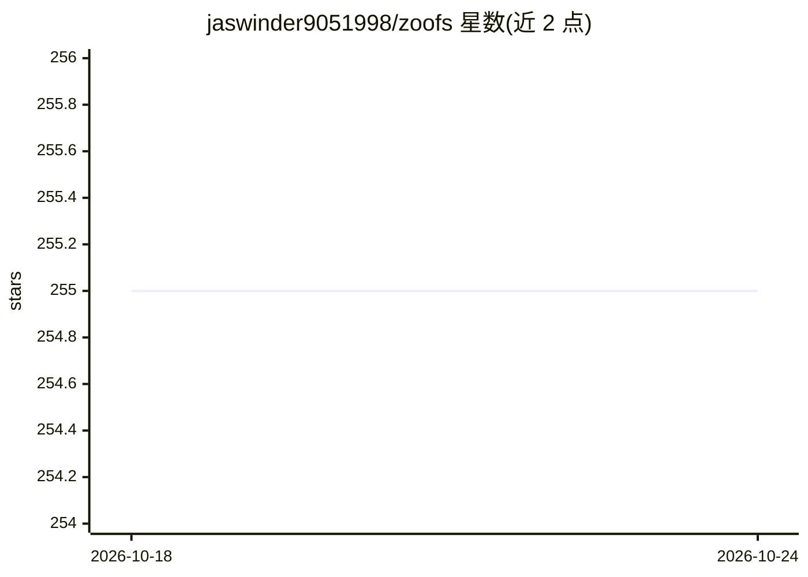

# jaswinder9051998/zoofs

⭐ 255 · Python · Apache-2.0 · 推送 2026-01-09 · [GitHub](https://github.com/jaswinder9051998/zoofs) · [官网](https://jaswinder9051998.github.io/zoofs/) · 个人维护

**面向 ML 从业者的自然启发式特征选择 Python 库**

zoofs 是用自然启发式包装算法做特征选择的 Python 库，提供粒子群、灰狼、蜻蜓、Harris 鹰、遗传、引力 6 种优化算法。用户自定义目标函数（签名 func(model,X_train,y_train,X_test,y_test)），传入任意机器学习模型对象与训练/验证数据，fit 后返回 best_feature_list。支持 n_iteration 与 timeout 两种停止条件，含已访问特征集的分数哈希以提升性能，并提供 plot_history 迭代历史绘图。输入要求 pandas DataFrame 格式。

## 筛选速览

| 维度 | 判定 | 备注 |
|---|---|---|
| AI 角色 | `ai-native` | 本体是模型或模型工具 |
| 许可风险 | `permissive` | Apache-2.0 |
| 部署形态 | `library` | 以包/库形式分发 |
| 模型依赖 | — | README 未给出锁定关系 |
| 硬件要求 | — | 无带数字的原话,不猜 |
| 安装摩擦 | `low` | 无编译、无系统依赖或容器化 |
| 成熟度 | — | 结构信号不足 |

## 能力要点

- 6 种自然启发式包装算法（粒子群/灰狼/蜻蜓/Harris 鹰/遗传/引力）
- 用户自定义目标函数，兼容任意 sklearn 风格模型对象
- timeout 秒级停止与已访问特征集分数哈希
- plot_history 绘制迭代过程中的目标分数变化

## 适用场景

- 我在建模前想用进化算法压缩特征维度
- 我想用自己的 ML 模型和评估指标驱动特征选择
- 我想对比多种群智能算法在同一数据集上的选特征效果

## 场景标签

 · 领域:机器学习/优化

## 证据(README 行号)

> L7: ``zoofs`` is a Python library for performing feature selection using a variety of nature inspired wrapper algorithms
> L68: - As available algorithms are wrapper algos, it is better to use ml models that build quicker, e.g lightgbm, catboo

## 星数曲线

2026-10-18 255 → 2026-10-24 255（+0）

---
*卡片 v1 · prompt 1.4 · 生成 2026-10-22 · 置信度 high · 依据 README sha `e8a93e831d48` · [字段定义](../../DATASET.md)*
