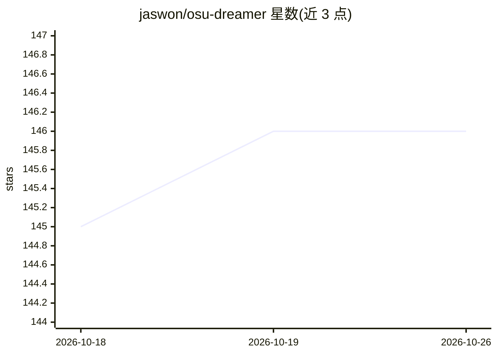

# jaswon/osu-dreamer

⭐ 146 · Python · MIT · 推送 2026-08-01 · [GitHub](https://github.com/jaswon/osu-dreamer) · 个人维护

**从原始音频生成 osu! 谱面的扩散模型**

基于扩散过程的 osu! 谱面生成模型：读取原始音频，经潜在模型、流模型、风格模型三阶段训练后，通过 predict 命令按音频生成谱面，可一次指定多个难度。提供无需安装的 Colab notebook，开发环境依赖 FFmpeg、Python 3.9 与 uv；Windows 本地训练支持为实验性质，通过批处理脚本完成安装与训练。训练需先用 osu!/Songs 目录生成数据集，可用 TensorBoard 跟踪进度。

## 筛选速览

| 维度 | 判定 | 备注 |
|---|---|---|
| AI 角色 | `ai-native` | 本体是模型或模型工具 |
| 许可风险 | `permissive` | MIT |
| 部署形态 | `None` |  |
| 模型依赖 | — | README 未给出锁定关系 |
| 硬件要求 | — | 无带数字的原话,不猜 |
| 安装摩擦 | `medium` | 含编译或系统依赖之一 |
| 成熟度 | `idea` | |

## 能力要点

- 从原始音频直接生成 osu! 谱面
- 三阶段训练流程（latent/denoiser/style），支持断点续训
- 提供免安装的 Colab notebook 快速上手
- 一次 predict 可生成多个难度的谱面

## 适用场景

- 给自己喜欢的歌曲自动生成 osu! 谱面
- 用自己的 Songs 目录训练个性化的谱面生成模型
- 在 Colab 上无需本地环境体验谱面生成

## 场景标签

`模型训练` · 领域:训练与推理

## 证据(README 行号)

> L1: # osu!dreamer - an ML model for generating maps from raw audio
> L5: osu!dreamer is a generative model for osu! beatmaps based on diffusion

## 星数曲线

2026-10-18 145 → 2026-10-26 146（+1）

---
*卡片 v1 · prompt 1.4 · 生成 2026-10-22 · 置信度 high · 依据 README sha `0432b6c3164d` · [字段定义](../../DATASET.md)*
