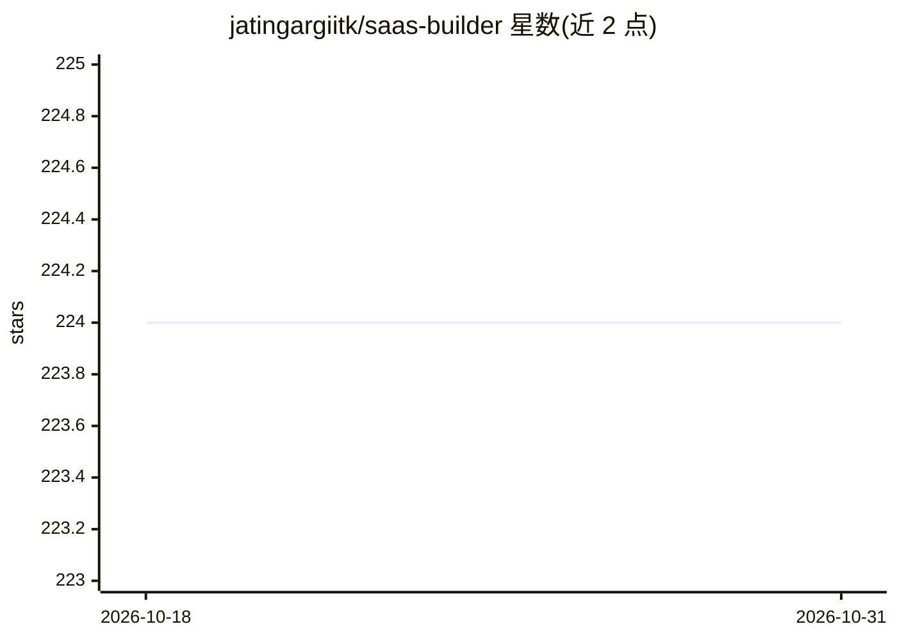

# jatingargiitk/saas-builder

⭐ 224 · Python · MIT · 推送 2026-10-27 · [GitHub](https://github.com/jatingargiitk/saas-builder) · [官网](https://gocodeo.com) · 个人维护

**AI 生成全栈 SaaS 应用的代码生成框架**

面向开发者的 CLI 框架，通过交互式向导（项目名、模板、技术栈、AI 模型选择）用自主 AI agent 将高层想法脚手架为全栈 SaaS 应用：生成 React + TypeScript 前端、Flask 后端、SQLite 数据库，并自动完成认证、schema 与迁移、依赖安装和开发服务器启动。支持选择 Claude 3.7 Sonnet、GPT-4.1 或 Gemini 2.5 Pro，仅需对应的一个 API key。以 PyPI 包与源码两种方式安装。

## 筛选速览

| 维度 | 判定 | 备注 |
|---|---|---|
| AI 角色 | `ai-ecosystem` | LLM/agent 周边工具 |
| 许可风险 | `permissive` | MIT |
| 部署形态 | `library` | 以包/库形式分发 |
| 模型依赖 | — | README 未给出锁定关系 |
| 硬件要求 | — | 无带数字的原话,不猜 |
| 安装摩擦 | `low` | 无编译、无系统依赖或容器化 |
| 成熟度 | — | 结构信号不足 |

## 能力要点

- 交互式向导生成 React + Flask + SQLite 全栈应用
- 自动完成认证、数据库 schema 与迁移、依赖安装、开发服务器启动
- 可选 Claude / GPT-4.1 / Gemini 三种模型，单一 API key 即可运行
- 内置 E-commerce / SaaS Marketing / CRM 等项目模板

## 适用场景

- 我想从一句产品想法快速得到可运行的全栈 SaaS 骨架
- 需要自带认证和数据库的应用起点来继续开发业务逻辑
- 选择不同 LLM 供应商来驱动代码生成流程

## 场景标签

`代码生成` · 领域:编码与开发

## 证据(README 行号)

> L7: SaaS-Builder is an AI-native framework designed to transform high-level ideas into fully functional SaaS application
> L9: Powered by cutting-edge AI models, SaaS-Builder automatically scaffolds full-stack React apps with Flask backend and

## 星数曲线

2026-10-18 224 → 2026-10-31 224（+0）

---
*卡片 v1 · prompt 1.4 · 生成 2026-10-22 · 置信度 high · 依据 README sha `1aa28a308b03` · [字段定义](../../DATASET.md)*
