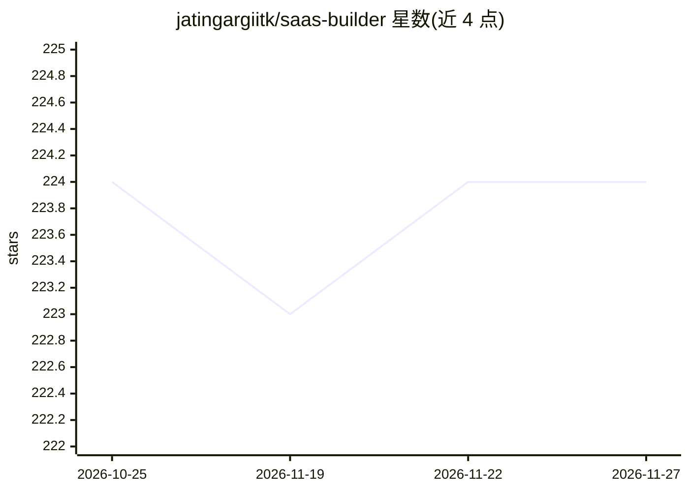

# jatingargiitk/saas-builder

⭐ 224 · Python · MIT · 推送 2026-10-27 · [GitHub](https://github.com/jatingargiitk/saas-builder) · [官网](https://gocodeo.com) · 个人维护

**AI agent 框架：从想法生成全栈 SaaS 应用**

SaaS-Builder 是一个以 CLI 形式发布的 AI 原生框架，通过自主 AI agent 将高层想法生成为可运行的全栈 SaaS 应用：自动搭建 React + TypeScript 前端、Flask 后端与 SQLite 数据库，包含认证与路由保护、数据模型与迁移、实时功能配置，并自动安装 npm/pip 依赖、启动开发服务器供即时预览。交互式 init 流程引导选择项目模板（电商/SaaS 营销/CRM）、技术栈与 AI 模型，所选模型只需一个 API key，写入 .env 即可运行。MIT 许可。

## 筛选速览

| 维度 | 判定 | 备注 |
|---|---|---|
| AI 角色 | `ai-ecosystem` | LLM/agent 周边工具 |
| 许可风险 | `permissive` | MIT |
| 部署形态 | `library` | 以包/库形式分发 |
| 模型依赖 | locked-api |  |
| 硬件要求 | — | 无带数字的原话,不猜 |
| 安装摩擦 | `low` | 无编译、无系统依赖或容器化 |
| 成熟度 | — | 结构信号不足 |

## 能力要点

- 交互式 init 流程生成 React+Flask+SQLite 全栈应用
- 内置认证、数据库 schema 与迁移的自动生成
- 自动安装依赖并启动前后端开发服务器
- 支持 4 种项目模板与 2 种技术栈组合

## 适用场景

- 从想法快速生成带认证和数据库的 SaaS 原型
- 用电商/CRM 模板初始化全栈项目脚手架
- 自动完成依赖安装与开发环境配置

## 场景标签

`代码生成` `编码 Agent` · 领域:编码与开发

## 证据(README 行号)

> L7: SaaS-Builder is an AI-native framework designed to transform high-level ideas into fully functional SaaS application
> L9: Powered by cutting-edge AI models, SaaS-Builder automatically scaffolds full-stack React apps with Flask backend and

## 星数曲线

2026-10-25 224 → 2026-11-27 224（+0）

---
*卡片 v1 · prompt 1.4 · 生成 2026-11-25 · 置信度 high · 依据 README sha `b950fbb0fd94` · [字段定义](../../DATASET.md)*
