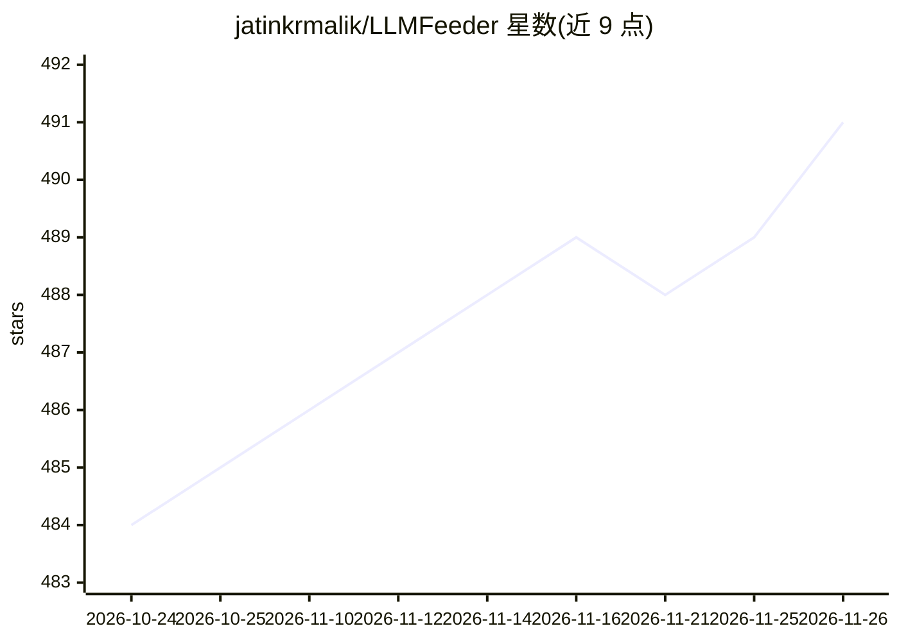

# jatinkrmalik/LLMFeeder

⭐ 491 · JavaScript · MIT · 推送 2026-11-21 · [GitHub](https://github.com/jatinkrmalik/LLMFeeder) · [官网](https://llmfeeder.fyi) · 个人维护

**一键把网页转为 Markdown 供 LLM 使用**

浏览器扩展（Chrome/Firefox），将网页内容提取并转换为干净的 Markdown，复制到剪贴板或下载为 .md 文件，用于粘贴给 LLM 作为上下文。基于 Readability 提取主内容、Turndown 做 HTML→Markdown 转换，全部在浏览器本地处理、无后端与遥测。支持多标签批量转换、懒加载自动滚动、token 计数、快捷键与右键菜单；可从商店安装、直接下载 zip 或源码构建。

## 筛选速览

| 维度 | 判定 | 备注 |
|---|---|---|
| AI 角色 | `ai-enhanced` | 去掉 AI 部分产品仍成立 |
| 许可风险 | `permissive` | MIT |
| 部署形态 | `library` | 以包/库形式分发 |
| 模型依赖 | — | README 未给出锁定关系 |
| 硬件要求 | — | 无带数字的原话,不猜 |
| 安装摩擦 | `low` | 无编译、无系统依赖或容器化 |
| 成熟度 | — | 结构信号不足 |

## 能力要点

- 一键转换网页为 Markdown 并复制/下载
- Readability 主内容提取 + Turndown HTML→Markdown
- 多标签批量转换（合并或 ZIP）、实时 token 计数（4K–32K 上下文限制）
- 完全客户端处理，无后端、无遥测

## 适用场景

- 把长网页文章作为上下文粘贴给 ChatGPT/Claude 等工具
- 批量抓取多个标签页内容转 Markdown 存档
- 剥离链接 URL 以减少 token 消耗

## 场景标签

`文档解析` · 领域:知识与检索

## 证据(README 行号)

> L11: A browser extension that converts web page content to clean Markdown format and copies it to clipboard with a singl
> L46: LLMFeeder operates as a fully client-side extension with zero backend dependencies. All content processing occurs l
> L80: ## Installation

## 星数曲线

2026-10-24 484 → 2026-11-26 491（+7）

---
*卡片 v1 · prompt 1.4 · 生成 2026-11-25 · 置信度 mid · 依据 README sha `cad95840eb4f` · [字段定义](../../DATASET.md)*
