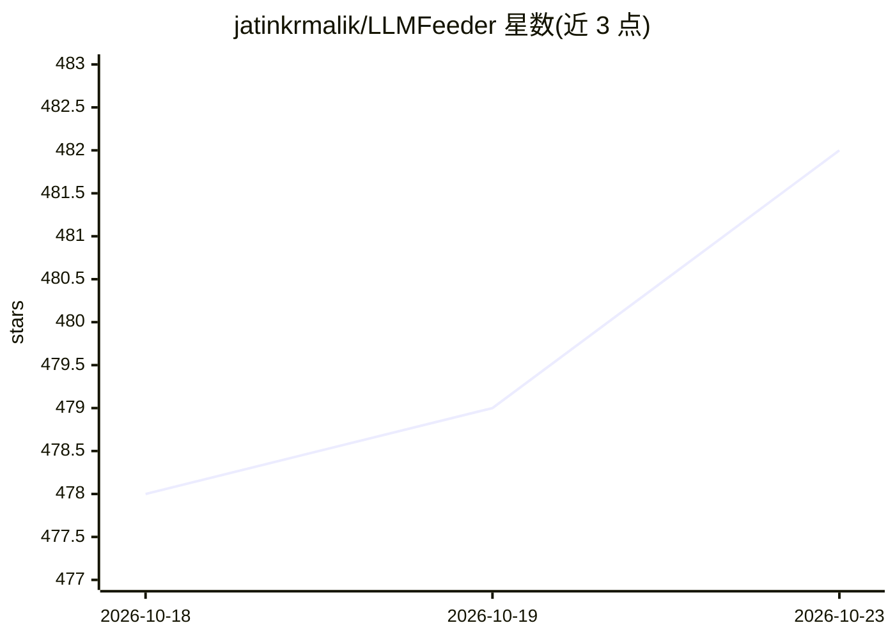

# jatinkrmalik/LLMFeeder

⭐ 482 · JavaScript · MIT · 推送 2026-09-05 · [GitHub](https://github.com/jatinkrmalik/LLMFeeder) · [官网](https://llmfeeder.fyi) · 个人维护

**一键把网页转成 Markdown 供 LLM 使用的浏览器扩展**

Chrome/Firefox 浏览器扩展，用 Readability 抽取网页主内容、Turndown 转为 Markdown，一键复制到剪贴板或下载 .md 文件，供粘贴给 LLM 作为上下文。支持多标签批量转换（合并/ZIP）、聊天页面懒加载自动滚动、实时 token 计数（GPT-4/Claude tokenizer）、链接/图片/元数据格式可配置。纯客户端运行，无后端、无遥测，权限最小化。可从应用商店、发行包 zip 或源码构建安装。

## 筛选速览

| 维度 | 判定 | 备注 |
|---|---|---|
| AI 角色 | `ai-enhanced` | 去掉 AI 部分产品仍成立 |
| 许可风险 | `permissive` | MIT |
| 部署形态 | `library` | 以包/库形式分发 |
| 模型依赖 | — | README 未给出锁定关系 |
| 硬件要求 | — | 无带数字的原话,不猜 |
| 安装摩擦 | `low` | 无编译、无系统依赖或容器化 |
| 成熟度 | — | 结构信号不足 |

## 能力要点

- Readability+Turndown 抽取主内容并转为 Markdown，一键复制/下载
- 多标签批量转换：合并单文件或打包 ZIP
- 实时 token 计数与可配置上下文上限（4K-32K）
- 纯客户端处理，零后端依赖、零遥测

## 适用场景

- 把网页文章快速转成 Markdown 粘贴给 ChatGPT/Claude 等模型作上下文
- 批量转换多个标签页内容并打包下载
- 导出 AI 聊天页面的长对话内容

## 场景标签

`网页抓取` `文档解析` · 领域:效率与自动化

## 证据(README 行号)

> L11: A browser extension that converts web page content to clean Markdown format and copies it to clipboard with a singl
> L46: LLMFeeder operates as a fully client-side extension with zero backend dependencies. All content processing occurs l
> L75: - **LLM-Optimized Output**: Clean, structured Markdown perfect for AI consumption

## 星数曲线

2026-10-18 478 → 2026-10-23 482（+4）

---
*卡片 v1 · prompt 1.4 · 生成 2026-10-21 · 置信度 mid · 依据 README sha `da3afe8e3f61` · [字段定义](../../DATASET.md)*
