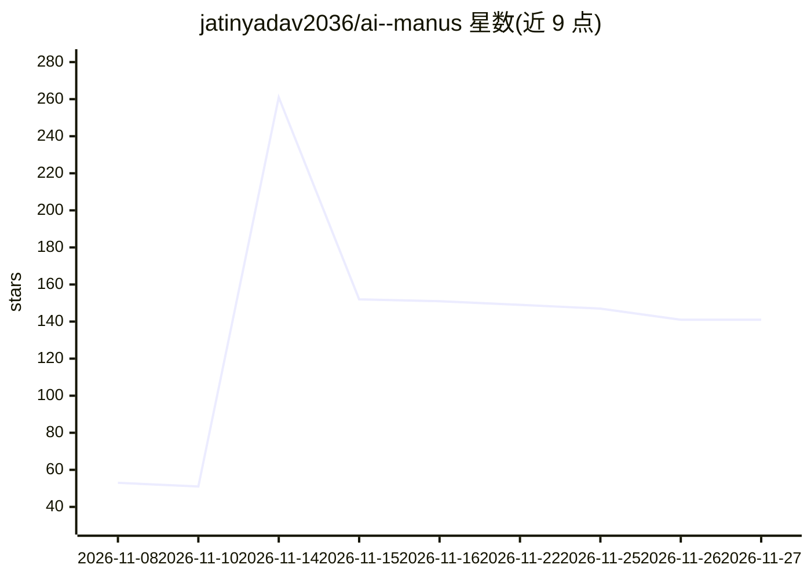

# jatinyadav2036/ai--manus

⭐ 141 · Apache-2.0 · 推送 2026-11-15 · [GitHub](https://github.com/jatinyadav2036/ai--manus) · 个人维护

**自主 AI Agent 系统：在沙箱中运行代码并控制浏览器完成任务**

自主 AI Agent 系统，支持在沙箱环境中运行各类工具与操作。Agent 可自主编写并执行脚本、控制浏览器（导航网页、填写表单、收集信息），并可跨代码与浏览器执行多步骤任务，需较少人工监督。定位为面向家庭、学习与轻量工作场景的个人助手，非企业平台。README 提供系统兼容性表格（最低双核 CPU、4 GB 内存）与使用流程说明，但未给出具体安装命令、API 接入方式或模型来源信息，实现细节不可验证。

## 筛选速览

| 维度 | 判定 | 备注 |
|---|---|---|
| AI 角色 | `ai-native` | 本体是模型或模型工具 |
| 许可风险 | `permissive` | Apache-2.0 |
| 部署形态 | `None` |  |
| 模型依赖 | — | README 未给出锁定关系 |
| 硬件要求 | — | 无带数字的原话,不猜 |
| 安装摩擦 | `low` | 无编译、无系统依赖或容器化 |
| 成熟度 | — | 结构信号不足 |

## 能力要点

- 自主执行代码完成任务
- 浏览器控制：导航、填表、信息收集
- 代码与浏览器操作可在同一多步骤任务流中衔接

## 适用场景

- 让学生整理研究笔记、跑小脚本
- 远程工作者从多个网页收集数据
- 用对话委托重复性的小任务给后台 Agent

## 场景标签

`AI 助手` `编码 Agent` `浏览器自动化` · 领域:效率与自动化

## 证据(README 行号)

> L18: Manus is an autonomous AI agent designed to run code and control a browser on your behalf. Instead of acting like a

## 星数曲线

2026-11-08 53 → 2026-11-27 141（+88）

---
*卡片 v1 · prompt 1.4 · 生成 2026-11-17 · 置信度 low · 依据 README sha `457a5fad1755` · [字段定义](../../DATASET.md)*
