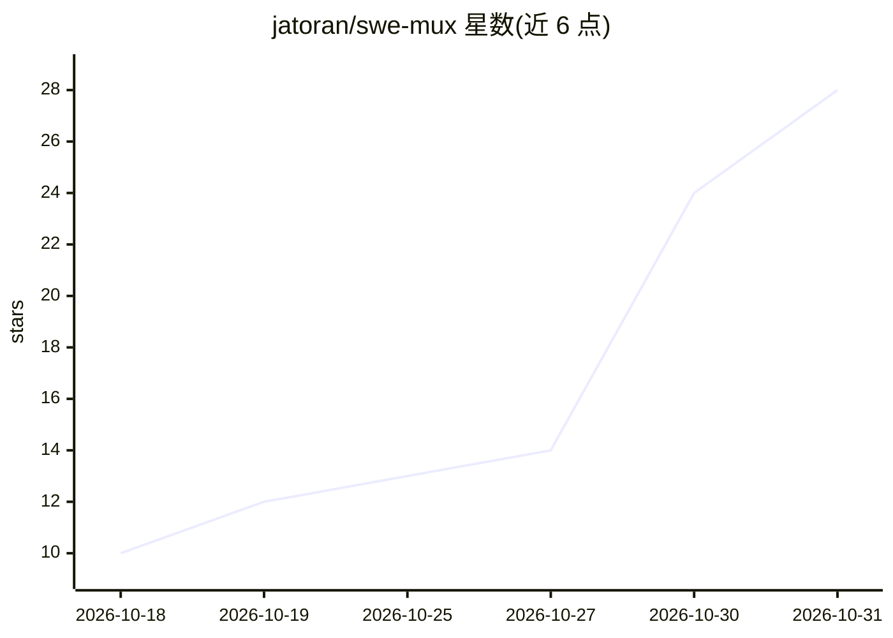

# jatoran/swe-mux

⭐ 28 · Python · Apache-2.0 · 推送 2026-10-29 · [GitHub](https://github.com/jatoran/swe-mux) · [官网](https://swemux.dev) · 个人维护

**终端多路复用器与编码 agent 控制台，手机经 Tailscale 远程操控**

在桌面与手机上并排运行 Claude Code、Codex 等编码 agent CLI 的终端复用器与控制台：提供实时状态、告警历史、推送通知、会话间消息、跨会话检索、分支合并队列等功能，手机端经用户自己的 Tailscale 网络访问终端、Git 审查与文件。附带本地语音识别（faster-whisper 或 Windows Speech Recognition）、可检查会话并提出操作的助手。agent CLI 须已安装并登录，swe-mux 不代理它们；数据留在本机，无账号后端。Windows 为主要平台，Linux/macOS 经浏览器 UI 运行。

## 筛选速览

| 维度 | 判定 | 备注 |
|---|---|---|
| AI 角色 | `ai-ecosystem` | LLM/agent 周边工具 |
| 许可风险 | `permissive` | Apache-2.0 |
| 部署形态 | `desktop` | 安装包/桌面程序 |
| 模型依赖 | — | README 未给出锁定关系 |
| 硬件要求 | — | 无带数字的原话,不猜 |
| 安装摩擦 | `low` | 无编译、无系统依赖或容器化 |
| 成熟度 | — | 结构信号不足 |

## 能力要点

- 多 agent 会话并排运行，实时状态、告警与推送通知
- 经自有 Tailscale 网络从手机访问终端、Git 审查与文件
- 本地语音识别（faster-whisper/Windows Speech Recognition），无云端语音路径
- 会话协调、分支合并队列与跨 agent 会话检索

## 适用场景

- 同时运行多个编码 agent 并追踪哪个需要人工介入
- 在手机上继续查看和操作桌面上的 agent 会话
- 统一切换个人拥有的 Claude/Codex 账号登录

## 场景标签

`多智能体` · 领域:Agent 开发

## 证据(README 行号)

> L3: **Run your coding agents together, on your desktop and your phone. Know which ones need you.**
> L5: Keep Claude Code, Codex and other coding agents side by side, with live status, flexible panes and messages between 
> L138: swe-mux launches and observes coding-agent CLIs published by other vendors, including Anthropic's Claude Code and 

## 星数曲线

2026-10-18 10 → 2026-10-31 28（+18）

---
*卡片 v1 · prompt 1.4 · 生成 2026-10-30 · 置信度 high · 依据 README sha `6ef105d6c1e6` · [字段定义](../../DATASET.md)*
