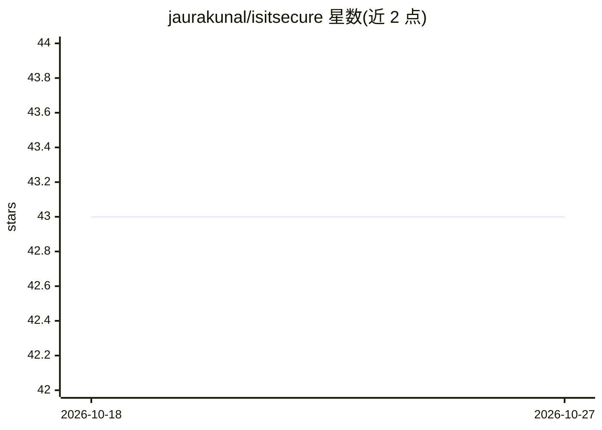

# jaurakunal/isitsecure

⭐ 43 · Python · Apache-2.0 · 推送 2026-10-26 · [GitHub](https://github.com/jaurakunal/isitsecure) · [官网](https://jaurakunal.github.io/isitsecure/) · 个人维护

**面向非安全专家的 Web 应用安全扫描器：SAST+DAST+LLM 审查一条命令**

单命令运行的 Web 应用安全扫描工具：默认 42 个（deep 模式 45 个）规则型扫描器覆盖 SAST（18 个，含 Semgrep 污点分析、git 密钥、路由鉴权）与 DAST（16+8 个，含 XSS、注入、IDOR、JWT、SSRF 等），SAST 发现会自动生成针对性 DAST 验证。AI 部分为可选组件（需 [llm] extra 与 API key）：LLM 代码审查、误报裁决、分级与生成 unified diff 修复补丁；无 API key 时全部规则扫描器仍可用。支持 Anthropic 与 Google 两个 LLM 提供商，语言覆盖 TS/JS、Python、Java/Kotlin、Go。Python 3.11+ 与 git 为前置要求，不在 PyPI 发布，经安装脚本或 git clone 安装。

## 筛选速览

| 维度 | 判定 | 备注 |
|---|---|---|
| AI 角色 | `ai-enhanced` | 去掉 AI 部分产品仍成立 |
| 许可风险 | `permissive` | Apache-2.0 |
| 部署形态 | `self-host` | docker 或自建部署 |
| 模型依赖 | locked-api |  |
| 硬件要求 | — | 无带数字的原话,不猜 |
| 安装摩擦 | `low` | 无编译、无系统依赖或容器化 |
| 成熟度 | — | 结构信号不足 |

## 能力要点

- 默认 42 个规则型扫描器，无 API key 即可运行 SAST+DAST
- SAST 发现自动生成针对性 DAST 测试并交叉引用验证可利用性
- LLM 可选层：业务逻辑审查、误报裁决、triage 与 diff 修复生成
- 支持登录态扫描（IDOR/BOLA/RLS/提权）与 --probe-writes 变异面测试

## 适用场景

- 上线前用一条命令检查我的 Web 应用有没有常见漏洞
- 不懂安全的开发者拿到分级报告与可粘贴到 Cursor/Claude Code 的修复计划
- 对自家应用做登录墙后的越权（IDOR/BOLA）与注入测试

## 场景标签

`网络安全` `代码审查` · 领域:编码与开发

## 证据(README 行号)

> L9: AI-powered security scanner for modern web apps. SAST + DAST + LLM code review in a single scan.
> L98: isitsecure is free and open source. The only cost is LLM API tokens for the AI-powered features:
> L104: |**Code-only + LLM review**|Yes|~$5–8|

## 星数曲线

2026-10-18 43 → 2026-10-27 43（+0）

---
*卡片 v1 · prompt 1.4 · 生成 2026-10-25 · 置信度 mid · 依据 README sha `66c8f25e9a67` · [字段定义](../../DATASET.md)*
