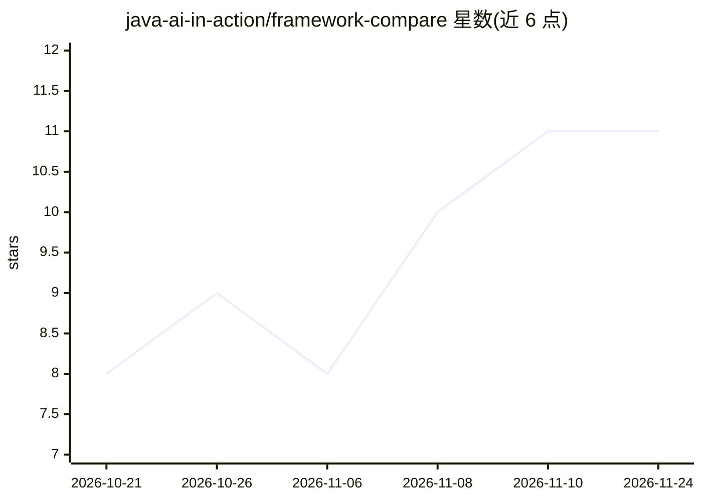

# java-ai-in-action/framework-compare

⭐ 11 · Java · MIT · 推送 2026-09-23 · [GitHub](https://github.com/java-ai-in-action/framework-compare) · 个人维护 · 中文 README

**Java 开发者对比 Spring AI/LangChain4j/SAA 三框架的可运行示例仓库**

用同一套场景（ChatClient 最小示例、多轮记忆、Function Calling、MCP、SSE 流式）分别以 Spring AI 2.0、LangChain4j 1.20、Spring AI Alibaba 1.0 实现三个 quickstart 子项目，配套 docker-compose 一键启动 pgvector/Qdrant/Redis，并附 6 维度实测脚本（模型集成/向量库/MCP/Agent/可观测/社区）与踩坑清单。面向 Java 后端开发者做框架选型，配套系列文章篇2，MIT 许可，Roadmap 中 RAG 与多 Agent 对比尚未完成。

## 筛选速览

| 维度 | 判定 | 备注 |
|---|---|---|
| AI 角色 | `ai-knowledge` | 知识聚合/清单类 |
| 许可风险 | `permissive` | MIT |
| 部署形态 | `self-host` | docker 或自建部署 |
| 模型依赖 | — | README 未给出锁定关系 |
| 硬件要求 | — | 无带数字的原话,不猜 |
| 安装摩擦 | `low` | 无编译、无系统依赖或容器化 |
| 成熟度 | — | 结构信号不足 |

## 能力要点

- 三个框架各自独立子项目，同一场景可直接对比运行
- docker-compose 一键启动 pgvector+Qdrant+Redis 基础设施
- 模型 API Key 支持 OpenAI 兼容协议、DeepSeek、阿里云百炼三种配置
- 含 6 维度实测脚本与 5 条版本/API 踩坑清单

## 适用场景

- 为 Java 项目选型 LLM 框架前跑通三套最小示例
- 对照 Spring AI 的 Step 1-5 学习记忆、工具调用与 MCP 接入
- 查看三框架在模型集成、向量库、可观测等维度的实测结果

## 场景标签

`教程课程` · 领域:学习与行业

## 证据(README 行号)

> L5: > 一个仓库跑通三个框架的最小可运行示例，用同一套场景对比代码量、配置方式与运行表现。
> L14: ├── benchmarks/                 # 6 维度实测脚本（模型集成/向量库/MCP/Agent/可观测/社区）

## 星数曲线

2026-10-21 8 → 2026-11-24 11（+3）

---
*卡片 v1 · prompt 1.4 · 生成 2026-11-18 · 置信度 high · 依据 README sha `ab759a0c8152` · [字段定义](../../DATASET.md)*
