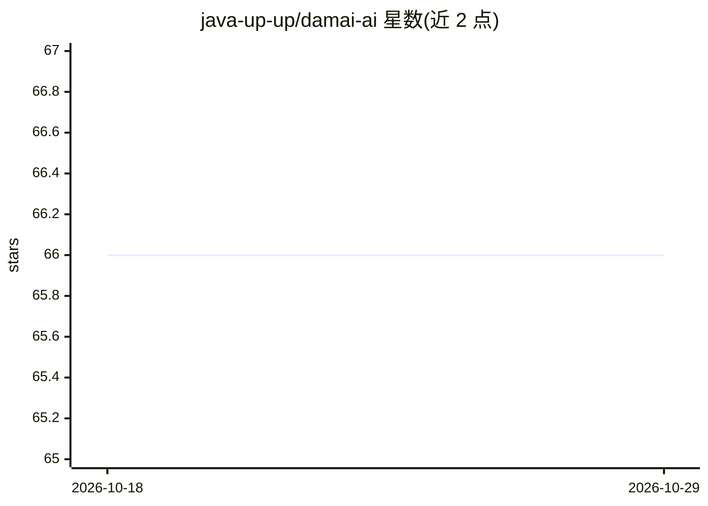

# java-up-up/damai-ai

⭐ 66 · Java · Apache-2.0 · 推送 2026-03-10 · [GitHub](https://github.com/java-up-up/damai-ai) · [官网](https://javaup.chat) · 个人维护 · 中文 README

**基于 SpringAI 的演唱会购票 AI 助手实战教学项目**

Java 教学项目，演示 SpringAI 与 SpringBoot3 集成，支持 Ollama、OpenAI、DeepSeek、阿里百炼多种模型接入。包含三个助手功能：贴心助手按用户对话推荐演唱会、查询票价余票并自动生成订单；规则助手基于预置规则内容用 RAG 回答订退票问题；运维助手查询日志、按 traceId 链路追踪并查看 JVM 指标。通过 MCP 与 Function Calling 与此前开发的大麦高并发项目联动，配有逐步搭建文档与从 0 到 1 的讲解视频。

## 筛选速览

| 维度 | 判定 | 备注 |
|---|---|---|
| AI 角色 | `ai-native` | 本体是模型或模型工具 |
| 许可风险 | `permissive` | Apache-2.0 |
| 部署形态 | `None` |  |
| 模型依赖 | local-ok | 支持本地模型 |
| 硬件要求 | — | 无带数字的原话,不猜 |
| 安装摩擦 | `low` | 无编译、无系统依赖或容器化 |
| 成熟度 | — | 结构信号不足 |

## 能力要点

- 支持 Ollama/OpenAI/DeepSeek/阿里百炼四种模型接入
- 对话式推荐演唱会、查询票价并自动生成订单
- RAG + 向量数据库回答订退票规则问题
- MCP 与 Function Calling 联动大麦主项目及日志/JVM 运维查询

## 适用场景

- 学习 SpringAI、RAG、MCP、Function Calling 在 Java 中的实战用法
- 参考可复用到公司项目的 AI 对话式业务架构
- 通过对话完成购票推荐、规则查询与运维排障的示例体验

## 场景标签

`RAG` `教程课程` · 领域:知识与检索

## 证据(README 行号)

> L17: **大麦AI** 是一套具有 AI 实战意义的项目，通过此项目能够帮助大家掌握 AI 的核心技能，包括：AI 的概念和作用、AI的模型、AI的使用、AI的开发。
> L19: 用户可以通过 AI 模型，智能的帮用户推荐想要看的节目和演唱会，显示节目和演唱会的详情介绍、演出时间、各个票档价格、是否有余票，以及帮助生成订单等功能。
> L35: - **不同 AI 模型的特点以及如何使用（Ollama、OpenAI、DeepSeek、阿里百炼）**

## 星数曲线

2026-10-18 66 → 2026-10-29 66（+0）

---
*卡片 v1 · prompt 1.4 · 生成 2026-10-24 · 置信度 mid · 依据 README sha `a07b157a766b` · [字段定义](../../DATASET.md)*
