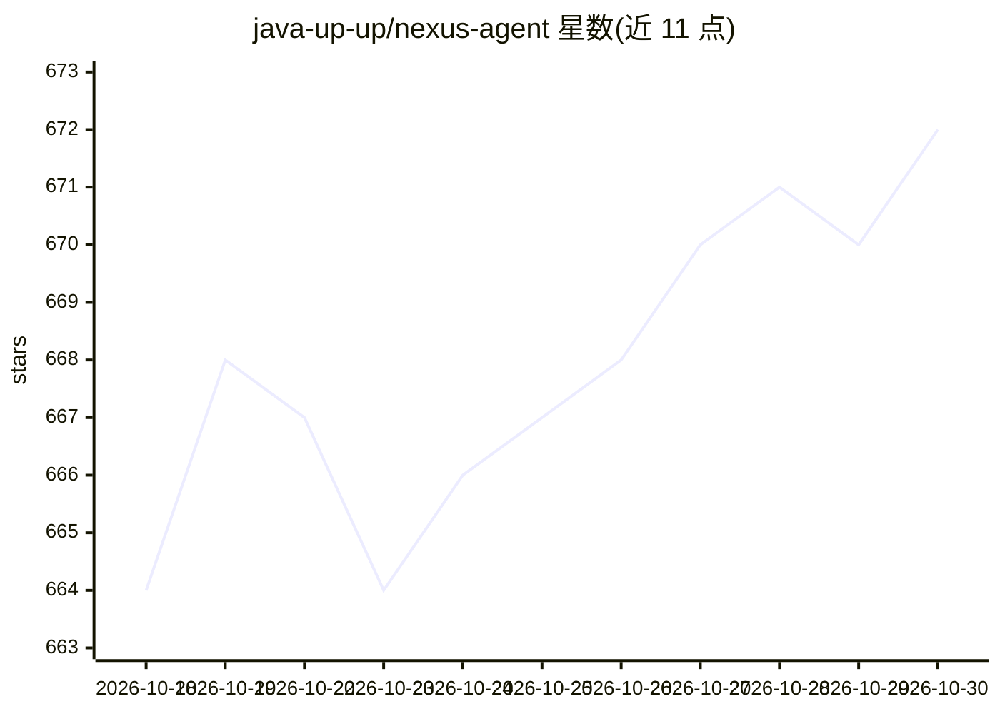

# java-up-up/nexus-agent

⭐ 672 · Java · Apache-2.0 · 推送 2026-10-21 · [GitHub](https://github.com/java-up-up/nexus-agent) · [官网](https://javaup.chat/super-agent/overview/project-intro) · 个人维护 · 中文 README

**企业级 AI 智能体对话平台：Agent、RAG 问答与工具调用全链路**

基于 Java/Spring AI 与 Vue 3 的企业级 AI 智能体对话平台：覆盖智能对话、文档知识问答、联网搜索、RAG 检索、MCP 工具协议与 Skills 能力扩展。核心机制包括三层执行器（歧义追问/知识问答/ReAct Agent）按场景分流、前置编排器（路由判定、问题改写、子问题拆分、知识域收缩、歧义检测）、双通道混合检索（PGVector+ES、RRF 融合、可选 Rerank）、Parent-Child 块聚合、无证据短路、三种会话记忆策略、Neo4j 文档结构图谱及 Redis 租约互斥等集群控制。README 面向校招/后端转 AI 方向的学习者，未在可见范围内给出具体安装命令。

## 筛选速览

| 维度 | 判定 | 备注 |
|---|---|---|
| AI 角色 | `ai-native` | 本体是模型或模型工具 |
| 许可风险 | `permissive` | Apache-2.0 |
| 部署形态 | `None` |  |
| 模型依赖 | — | README 未给出锁定关系 |
| 硬件要求 | — | 无带数字的原话,不猜 |
| 安装摩擦 | `low` | 无编译、无系统依赖或容器化 |
| 成熟度 | — | 结构信号不足 |

## 能力要点

- 三层执行器体系（歧义追问/RAG 知识问答/ReAct Agent）按场景分流
- 双通道混合检索：向量+关键词并行、RRF 融合、可选外部 Rerank 精排
- 组合式切块引擎：结构/递归/语义/LLM 智能切块四种策略组合
- MCP 工具协议集成与 SKILL.md 声明式 Skills 扩展、自动加载

## 适用场景

- 搭建带文档知识问答与引用溯源的企业对话平台
- 通过自然语言让 Agent 联网搜索、调用外部工具完成多步任务
- 学习企业级 RAG/Agent 全链路工程化实现（面试与转型）
- 治理文档：上传解析、切块、双引擎索引与知识路由

## 场景标签

`RAG` `文档问答` `聊天机器人` · 领域:对话与助手

## 证据(README 行号)

> L33: **Nexus Agent** 是一个 **企业级** 的 AI 智能体对话平台，覆盖智能对话、文档知识问答、联网搜索、RAG 检索、MCP 工具协议、Skills 能力扩展、Harness 工程化控制、会话记忆管理、等完整能力。
> L47: - **ReAct Agent 智能体的完整实现**：不只是能聊天，而是支持联网搜索、工具调用、多步推理、Checkpoint 持久化，真正能自主决策和行动的 Agent。

## 星数曲线

2026-10-18 664 → 2026-10-30 672（+8）

---
*卡片 v1 · prompt 1.4 · 生成 2026-10-21 · 置信度 high · 依据 README sha `25c8cf084c6c` · [字段定义](../../DATASET.md)*
