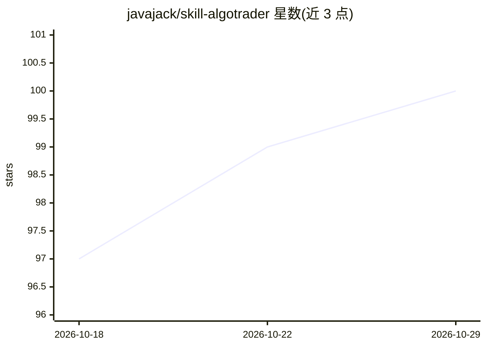

# javajack/skill-algotrader

⭐ 100 · Python · 推送 2026-02-14 · [GitHub](https://github.com/javajack/skill-algotrader) · 个人维护

**面向 Claude Code 的印度股市量化交易技能包**

一个 Claude Code skill（技能扩展），为在印度股票市场构建、优化和运行量化交易系统提供指导与工具：交互式向导生成完整交易 bot、从 NSE 抓取指数成分股、分析已有交易代码，并内置 16 个知识域（Zerodha 集成、信号生成、风险管理、回测-实盘一致性等）与 30+ 生产陷阱文档。通过 npx skills 或 git clone 安装到 Claude 技能目录，需另建 Python 虚拟环境，实盘交易需配置 Zerodha API 凭证。声明仅为教育性指导，不执行交易、不保证收益。

## 筛选速览

| 维度 | 判定 | 备注 |
|---|---|---|
| AI 角色 | `ai-ecosystem` | LLM/agent 周边工具 |
| 许可风险 | `none` | — |
| 部署形态 | `library` | 以包/库形式分发 |
| 模型依赖 | — | README 未给出锁定关系 |
| 硬件要求 | — | 无带数字的原话,不猜 |
| 安装摩擦 | `low` | 无编译、无系统依赖或容器化 |
| 成熟度 | — | 结构信号不足 |

## 能力要点

- 交互式向导生成含风控/日志/分析模块的完整交易 bot
- 从 NSE 实时抓取 Nifty 50/100/中盘 150 成分股并做流动性过滤
- 16 个知识域与 30+ 生产陷阱文档（KNOWLEDGE.md 1,780 行）
- Kelly 仓位、市场状态检测（BULL/BEAR/SIDEWAYS）等风控函数

## 适用场景

- 我在 Claude Code 里生成自己的印度股市量化交易 bot
- 我需要 Zerodha 集成的 tick size、对账等生产细节指导
- 我想核对自己的回测与实盘表现不一致的原因

## 场景标签

`金融量化` · 领域:学习与行业

## 证据(README 行号)

> L1: # AlgoTrader: Quantitative Trading Skill for Claude Code
> L13: AlgoTrader is a Claude Code skill that provides expert guidance for building, optimizing, and running quantitative 
> L36: cd ~/.claude/skills

## 星数曲线

2026-10-18 97 → 2026-10-29 100（+3）

---
*卡片 v1 · prompt 1.4 · 生成 2026-10-23 · 置信度 high · 依据 README sha `f948bf94dd6f` · [字段定义](../../DATASET.md)*
