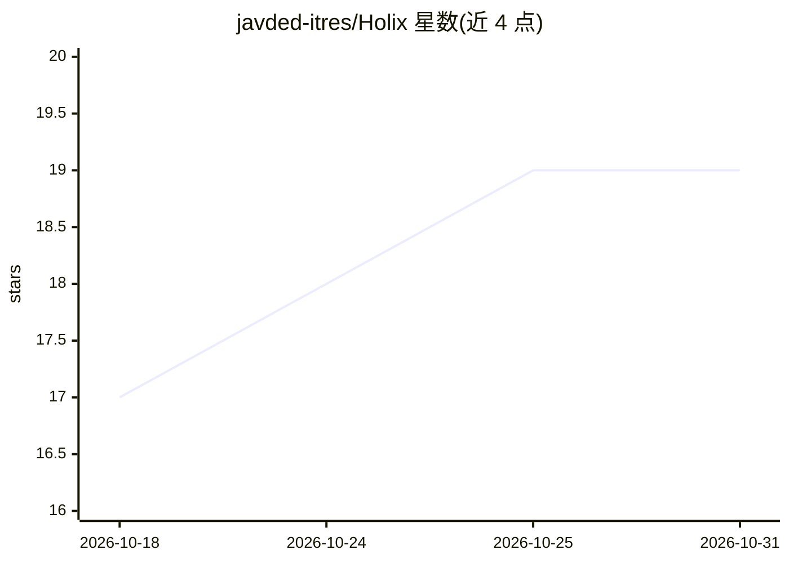

# javded-itres/Holix

⭐ 19 · Python · MIT · 推送 2026-10-28 · [GitHub](https://github.com/javded-itres/Holix) · [官网](https://holix-agent.ru) · 组织维护

**自我改进的 CLI AI agent：持久记忆、技能与多模型接入**

面向终端用户的 Python 自学习 agent：支持工具调用（文件/shell/网页/Playwright 浏览器）、SQLite 会话记忆与 ChromaDB 语义检索、markdown 技能自动生成与 ClawHub/Hermes/Claude 插件目录、按 agent 配置 MCP 服务器。多 provider 接入 Ollama、LiteLLM、OpenAI、Groq 及任意 OpenAI 兼容 API；提供 TUI、CLI、Telegram、MAX 接口与 API gateway，配套单用户本地 IDE（Studio CE）与团队云服务（holix-studio.ru）。核心 MIT 许可，可用 pipx/脚本/Docker 安装。

## 筛选速览

| 维度 | 判定 | 备注 |
|---|---|---|
| AI 角色 | `ai-native` | 本体是模型或模型工具 |
| 许可风险 | `permissive` | MIT |
| 部署形态 | `self-host` | docker 或自建部署 |
| 模型依赖 | local-ok | 支持本地模型 |
| 硬件要求 | — | 无带数字的原话,不猜 |
| 安装摩擦 | `low` | 无编译、无系统依赖或容器化 |
| 成熟度 | — | 结构信号不足 |

## 能力要点

- SQLite 持久记忆 + ChromaDB 语义检索
- markdown 技能自动生成与 ClawHub/Hermes/Claude 插件技能目录
- 多 provider：Ollama/LiteLLM/OpenAI/Groq/OpenAI 兼容 API
- TUI/CLI/Telegram/MAX 接口与 API gateway、Docker 部署

## 适用场景

- 在终端或 Telegram 中运行带持久记忆的 AI 助手
- 让 agent 学习成功任务并沉淀可复用技能
- 通过 MCP 与多种工具服务器扩展 agent 能力
- 自托管 gateway 对接本地 Ollama 模型

## 场景标签

`AI 助手` `Agent 记忆` · 领域:Agent 开发

## 证据(README 行号)

> L5:  Self-improving AI agent — persistent memory, skills, MCP, CLI/TUI, Telegram and MAX.
> L62: - **Multi-provider** — Ollama, LiteLLM, OpenAI, Groq, and any OpenAI-compatible API
> L186: HolixAgent → run_agent_loop() (core/agent_execution.py)

## 星数曲线

2026-10-18 17 → 2026-10-31 19（+2）

---
*卡片 v1 · prompt 1.4 · 生成 2026-10-28 · 置信度 high · 依据 README sha `e4034ff844f2` · [字段定义](../../DATASET.md)*
