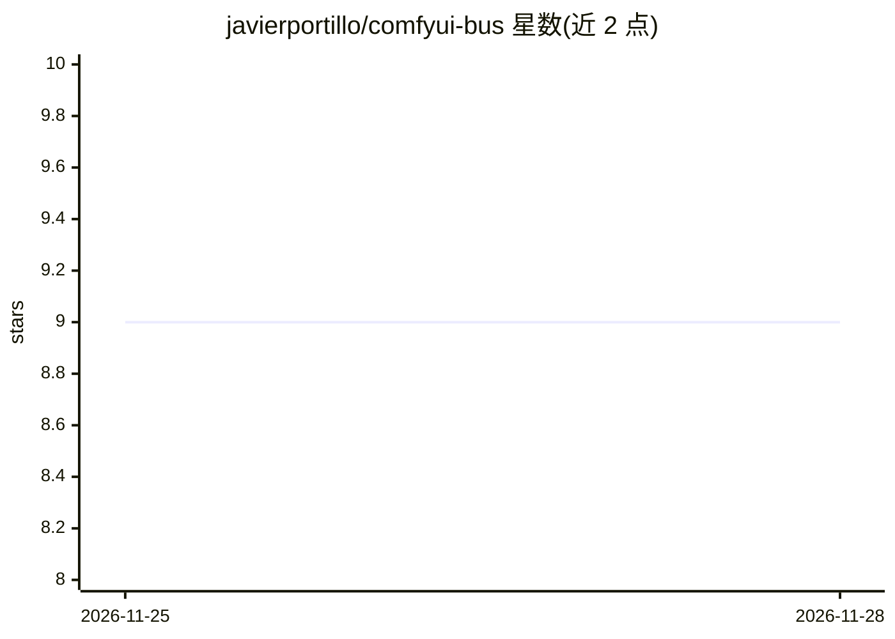

# javierportillo/comfyui-bus

⭐ 9 · JavaScript · MIT · 推送 2026-11-22 · [GitHub](https://github.com/javierportillo/comfyui-bus) · 个人维护

**ComfyUI 工作流的 Bus 节点：按 id 远程继承传递成员**

为 ComfyUI 提供的前端自定义节点，以总线方式组织工作流连线：成员动态创建、具名且带类型，其他 Bus 通过 id 指定 source 即可远程继承成员，无需画布间连线；支持在下游覆盖、扩展成员，断线不删除成员，改序重命名不影响身份（基于隐藏 uid）。节点仅在前端实现，通过 resolveVirtualOutput 钩子在提交 prompt 时展开为普通连线，不影响缓存、校验与 API 导出。需 ComfyUI 前端 ≥1.58.5，无 Python 依赖。

## 筛选速览

| 维度 | 判定 | 备注 |
|---|---|---|
| AI 角色 | `ai-ecosystem` | LLM/agent 周边工具 |
| 许可风险 | `permissive` | MIT |
| 部署形态 | `None` |  |
| 模型依赖 | — | README 未给出锁定关系 |
| 硬件要求 | — | 无带数字的原话,不猜 |
| 安装摩擦 | `low` | 无编译、无系统依赖或容器化 |
| 成熟度 | — | 结构信号不足 |

## 能力要点

- 通过 id 远程继承成员，无需画布间连线
- 成员覆盖与扩展，断线不删除成员，身份由隐藏 uid 维系
- 纯前端虚拟节点实现，prompt 展开为普通连线
- 队列时一次性报告未馈送成员、缺失来源、重复 id 与环路

## 适用场景

- 把大工作流按分段组织总线，减少跨画布连线
- 在子图边界之间传递成员而不破坏连线结构
- 管理需要频繁重命名与重排的工作流槽位

## 场景标签

`图像生成` · 领域:内容生成

## 证据(README 行号)

> L5: A dynamic, remote-capable **Bus** node for ComfyUI. Plug anything in once, then pick it up from any other Bus by id.
> L24: - 🧩 **Zero backend footprint.** Bus is frontend-only. The prompt sent to the backend contains plain links, so cachi
> L41: Requires ComfyUI frontend ≥ 1.58.5. No Python dependencies.

## 星数曲线

2026-11-25 9 → 2026-11-28 9（+0）

---
*卡片 v1 · prompt 1.4 · 生成 2026-11-24 · 置信度 high · 依据 README sha `086488ad0ba7` · [字段定义](../../DATASET.md)*
