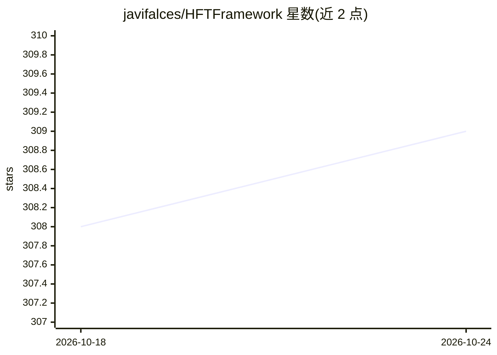

# javifalces/HFTFramework

⭐ 309 · Jupyter Notebook · Apache-2.0 · 推送 2026-10-18 · [GitHub](https://github.com/javifalces/HFTFramework) · 个人维护

**Java+Python 高频交易研究框架：L2级回测与实盘接口**

面向研究的高频交易框架，用 Java 与 Python 编写。通过连接器（进程内或经 ZeroMQ 远程）接入实盘市场，并支持与实盘同一套代码在 L2 tick 数据级别回测。内置做市算法（ConstantSpread、Avellaneda-Stoikov），支持纯 Python 策略（TCP/IPC 传输、JSON/Msgpack 编码）、模拟交易模式、组合快照查询，并提供 Gymnasium 环境包装器用于强化学习训练。配套 PLOS ONE 论文（Alpha-AS 模型）。README 明确声明未在实盘交易环境验证。

## 筛选速览

| 维度 | 判定 | 备注 |
|---|---|---|
| AI 角色 | `ai-ecosystem` | LLM/agent 周边工具 |
| 许可风险 | `permissive` | Apache-2.0 |
| 部署形态 | `None` |  |
| 模型依赖 | — | README 未给出锁定关系 |
| 硬件要求 | — | 无带数字的原话,不猜 |
| 安装摩擦 | `low` | 无编译、无系统依赖或容器化 |
| 成熟度 | — | 结构信号不足 |

## 能力要点

- L2 tick 数据回测与实盘共用同一代码库
- ZeroMQ 连接器接入实盘市场（XChangeEngine / MetatraderEngine）
- 纯 Python 策略支持 TCP/IPC 传输与 JSON/Msgpack 编码
- 提供 Gymnasium 环境包装器用于 RL 训练（alpha_as_env.py）

## 适用场景

- 开发和回测做市/交易策略后接入实盘市场
- 用强化学习训练 Avellaneda-Stoikov 做市智能体
- 在 L2 tick 数据上分析策略表现

## 场景标签

`金融量化` · 领域:学习与行业

## 证据(README 行号)

> L7: This repository is home to a High-Frequency Trading (HFT) framework, developed using Java and Python, primarily for
> L174: 4. **[alpha_as_env.py](python/python_algo/examples/alpha_as_env.py)** - Gymnasium environment wrapper for RL train
> L252: @article{10.1371/journal.pone.0277042,

## 星数曲线

2026-10-18 308 → 2026-10-24 309（+1）

---
*卡片 v1 · prompt 1.4 · 生成 2026-10-21 · 置信度 high · 依据 README sha `f038f667b552` · [字段定义](../../DATASET.md)*
