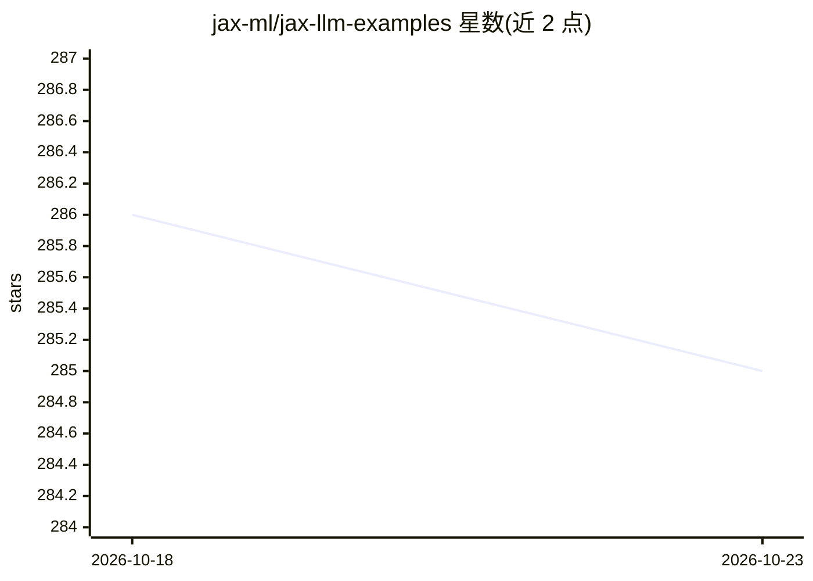

# jax-ml/jax-llm-examples

⭐ 285 · Python · Apache-2.0 · 推送 2026-08-23 · [GitHub](https://github.com/jax-ml/jax-llm-examples) · 组织维护

**JAX 编写的高性能 LLM 实现示例集，覆盖多家主流模型**

以纯 JAX 编写的大语言模型实现示例合集，处于进行中状态。当前收录 DeepSeek R1、Llama 4/3、Qwen 3、Kimi K2、OpenAI GPT OSS、NVIDIA Nemotron 3 Nano、Gemma 4 等模型的实现。README 提供多主机集群与分布式训练的说明文档（multi_host_README.md）与 tpu_toolkit.sh 脚本。面向需要在 JAX 生态中研究或运行 LLM 的开发者与科研人员。可见范围内未给出安装命令，仓库自述为进行中状态。

## 筛选速览

| 维度 | 判定 | 备注 |
|---|---|---|
| AI 角色 | `ai-ecosystem` | LLM/agent 周边工具 |
| 许可风险 | `permissive` | Apache-2.0 |
| 部署形态 | `None` |  |
| 模型依赖 | — | README 未给出锁定关系 |
| 硬件要求 | — | 无带数字的原话,不猜 |
| 安装摩擦 | `low` | 无编译、无系统依赖或容器化 |
| 成熟度 | `idea` | |

## 能力要点

- 纯 JAX 实现的 LLM 示例集合
- 覆盖 DeepSeek R1、Llama 3/4、Qwen 3、Kimi K2 等 8 种模型
- 附多主机集群与分布式训练说明及 tpu_toolkit.sh 脚本

## 适用场景

- 参考 JAX 实现学习 LLM 结构与高性能写法
- 在 JAX/TPU 集群上运行或扩展主流开源模型实现

## 场景标签

 · 领域:LLM 实现/机器学习框架示例

## 证据(README 行号)

> L3: A collection (in progress) of example high-performance large language model
> L4: implementations, written with JAX.

## 星数曲线

2026-10-18 286 → 2026-10-23 285（-1）

---
*卡片 v1 · prompt 1.4 · 生成 2026-10-22 · 置信度 mid · 依据 README sha `e3ae0f20c31b` · [字段定义](../../DATASET.md)*
