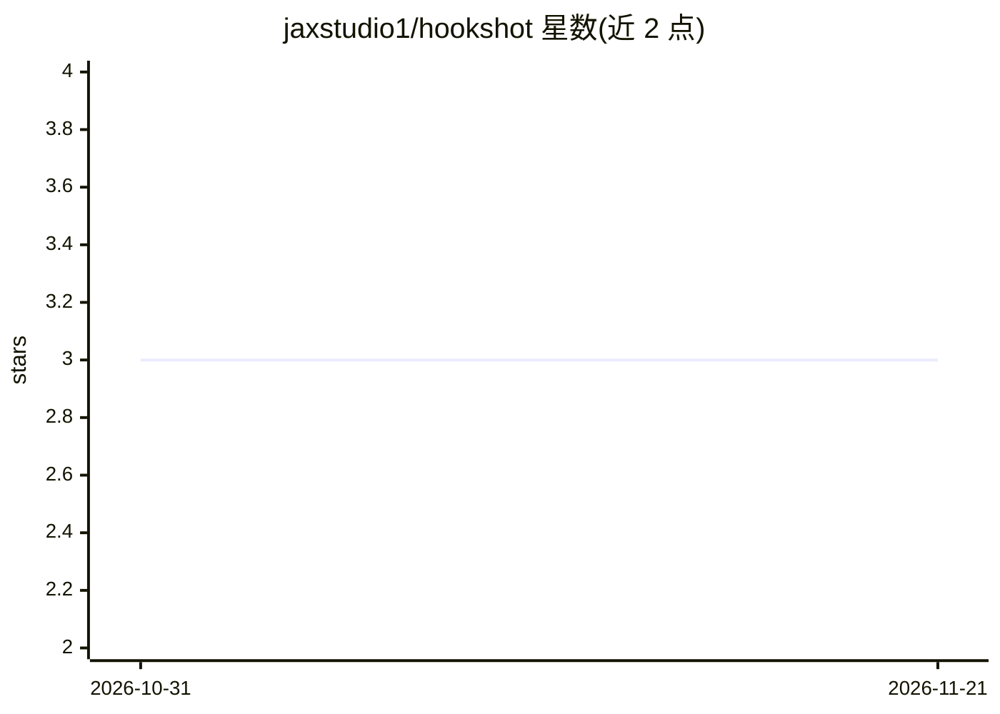

# jaxstudio1/hookshot

⭐ 3 · Python · MIT · 推送 2026-10-17 · [GitHub](https://github.com/jaxstudio1/hookshot) · 个人维护

**本地运行：把 YouTube 长视频自动剪成带字幕的竖屏短视频**

Hookshot 是一个在本地 Windows PC 运行的视频切片工具：输入 YouTube 链接或本地视频文件，经 yt-dlp 下载、faster-whisper 转录后，按 hook/情绪/关键词/节奏/收尾等加权信号打分，并用本地 LLM（通过 Ollama 运行 Qwen3 8B）对片段做评判并生成标题与话题标签，输出 9:16 竖屏短片、逐字字幕与缩略图。支持三种画面布局与人脸检测自动选择，提供发布队列按时间段自动发布到 YouTube Shorts 和 TikTok。默认面向 Windows，提供 setup.bat 一键安装，macOS/Linux 为未测试的手动安装路径。

## 筛选速览

| 维度 | 判定 | 备注 |
|---|---|---|
| AI 角色 | `ai-native` | 本体是模型或模型工具 |
| 许可风险 | `permissive` | MIT |
| 部署形态 | `desktop` | 安装包/桌面程序 |
| 模型依赖 | local-ok | 支持本地模型 |
| 硬件要求 | `cpu-ok` | |
| 安装摩擦 | `medium` | 含编译或系统依赖之一 |
| 成熟度 | — | 结构信号不足 |

## 能力要点

- Virality Score 由可测信号加权（hook 30%/情绪 25% 等）并叠加 YouTube "Most replayed" 数据
- 本地 AI 评判（Ollama + qwen3:8b）打分 hook/情绪/收尾/品牌安全并生成标题、字幕文案
- 三种布局：track 跟随人脸、stack 人像+游戏画面、fit 模糊背景，auto 用 YuNet 人脸检测自动选
- 发布队列支持 YouTube Shorts 定时发布与 TikTok 发布（TikTok API 不支持排期）

## 适用场景

- 把多小时的直播 VOD 批量剪成适合 Shorts/TikTok/Reels 的竖屏片段
- 为每个片段自动生成三张竖版封面和一张 YouTube 缩略图
- 审批后按每日时段自动发布到 YouTube Shorts
- 无订阅费用、不上传云端地在本机处理切片流程

## 场景标签

`语音识别` `图像视频处理` · 领域:感知与多模态

## 证据(README 行号)

> L3: **Paste a YouTube link. Get scroll-stopping vertical clips. 100% free, 100% local.**
> L5: Hookshot watches a long video or a multi-hour stream, finds the moments most likely to go viral, and turns them into
> L98: 4. **AI judge.** The best non-overlapping segments go to a local LLM (Ollama + `qwen3:8b`), which grades each one 0

## 星数曲线

2026-10-31 3 → 2026-11-21 3（+0）

---
*卡片 v1 · prompt 1.4 · 生成 2026-11-21 · 置信度 mid · 依据 README sha `0b0c11b356c1` · [字段定义](../../DATASET.md)*
