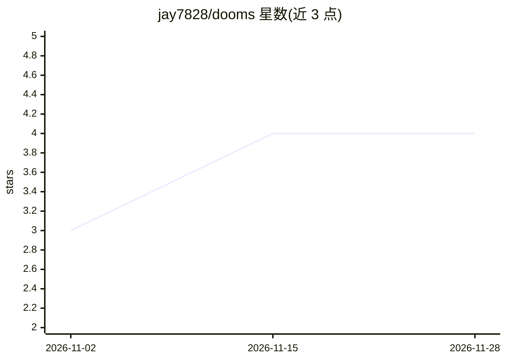

# jay7828/dooms

⭐ 4 · C++ · Apache-2.0 · 推送 2026-10-23 · [GitHub](https://github.com/jay7828/dooms) · [官网](https://dooms-kappa.vercel.app) · 个人维护

**面向 Apple Silicon 的本地推理引擎：LLM/语音/VLA**

为 Apple Silicon 构建的推理引擎，通过 C++/C/Python 接口在 Metal GPU 与 Neural Engine（Core ML）上运行文本大模型、视觉语言模型（SmolVLM）、语音识别（Whisper）、语音合成（Kokoro-82M）与视觉语言动作模型（SmolVLA）。内置自有 Metal 解码器处理 f16 与 4-bit GGUF 的 llama/Qwen2 模型，其他 GGUF 架构通过拉取的 llama.cpp 支持；提供 OpenAI 兼容服务器、`dooms pull` 校验下载模型、Python wheel 与 CMake SDK。仅支持 Apple Silicon macOS，不含训练功能。

## 筛选速览

| 维度 | 判定 | 备注 |
|---|---|---|
| AI 角色 | `ai-ecosystem` | LLM/agent 周边工具 |
| 许可风险 | `permissive` | Apache-2.0 |
| 部署形态 | `library` | 以包/库形式分发 |
| 模型依赖 | local-ok | 支持本地模型 |
| 硬件要求 | — | 无带数字的原话,不猜 |
| 安装摩擦 | `medium` | 含编译或系统依赖之一 |
| 成熟度 | — | 结构信号不足 |

## 能力要点

- 自有 Metal 解码器运行 llama/Qwen2 的 f16 与 4-bit GGUF，其他 GGUF 经 llama.cpp 支持
- Whisper 语音识别、Kokoro 语音合成、SmolVLM 视觉语言、SmolVLA 机器人动作模型
- OpenAI 兼容服务器（dooms serve）与 SHA-256 校验的 dooms pull 模型下载
- 提供 Python wheel、C/C++ CMake SDK 与 CLI

## 适用场景

- 在 Mac 上本地运行 LLM、Whisper 转录与 TTS
- 为 Apple Silicon 应用嵌入 C++/Python 推理能力
- 在仿真控制循环中给机器人提供视觉语言动作推理

## 场景标签

`推理引擎` · 领域:训练与推理

## 证据(README 行号)

> L3: An inference engine for Apple Silicon that runs language, speech (Whisper, Kokoro text to speech), vision-language a
> L13:  seeded sampling, and an OpenAI-compatible server (`dooms serve`).
> L21: Apple Silicon macOS only. The engine is an inference engine, not a trainer.

## 星数曲线

2026-11-02 3 → 2026-11-28 4（+1）

---
*卡片 v1 · prompt 1.4 · 生成 2026-11-21 · 置信度 high · 依据 README sha `cd06e61209af` · [字段定义](../../DATASET.md)*
