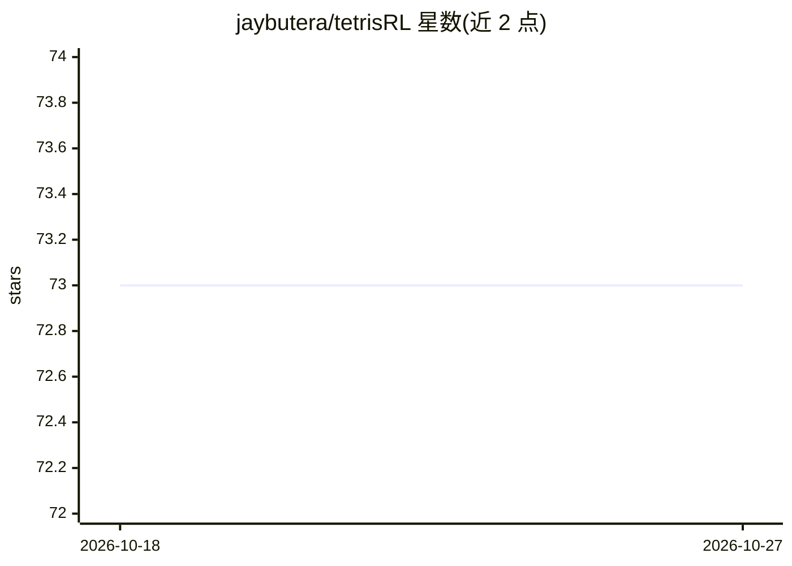

# jaybutera/tetrisRL

⭐ 73 · Python · MIT · 推送 2026-02-18 · [GitHub](https://github.com/jaybutera/tetrisRL) · 个人维护

**训练机器学习智能体的俄罗斯方块环境，含 DQN/监督学习**

提供一个类 OpenAI Gym 接口的俄罗斯方块环境 TetrisEngine，可自定义棋盘尺寸，逐步返回 (state, reward, done)。内置三种用法：用户游玩积累 (state, reward, done, action) 数据集训练监督学习卷积模型；DQN 强化学习智能体以动作自由度（棋盘熵）为优化目标训练；加载 checkpoint 在可视化界面评估模型。游戏规则与常规俄罗斯方块略有不同（每个动作伴随一次软降），以保证训练数据与 AI 玩法一致。通过 git clone 源码并以 uv 运行。

## 筛选速览

| 维度 | 判定 | 备注 |
|---|---|---|
| AI 角色 | `ai-native` | 本体是模型或模型工具 |
| 许可风险 | `permissive` | MIT |
| 部署形态 | `library` | 以包/库形式分发 |
| 模型依赖 | — | README 未给出锁定关系 |
| 硬件要求 | — | 无带数字的原话,不猜 |
| 安装摩擦 | `low` | 无编译、无系统依赖或容器化 |
| 成熟度 | — | 结构信号不足 |

## 能力要点

- 类 OpenAI Gym 接口的俄罗斯方块环境，可自定义宽高
- DQN 智能体以最大化棋盘熵（动作自由度）为优化目标
- 同一卷积模型可从用户游玩数据集做监督学习训练
- 支持 checkpoint 恢复训练与可视化评估

## 适用场景

- 在俄罗斯方块环境上训练和评估 DQN 强化学习智能体
- 通过自己游玩积累数据集训练监督学习模型
- 作为强化学习/监督学习的教学或实验环境

## 场景标签

`强化学习` · 领域:训练与推理

## 证据(README 行号)

> L15: * src/dqn_agent.py - DQN reinforcement learning agent trains on tetris
> L16: * src/supervised_agent.py - The same convolutional model as DQN trains on a dataset of user playthroughs
> L25: ### Using the Environment

## 星数曲线

2026-10-18 73 → 2026-10-27 73（+0）

---
*卡片 v1 · prompt 1.4 · 生成 2026-10-24 · 置信度 mid · 依据 README sha `b7cec3712243` · [字段定义](../../DATASET.md)*
