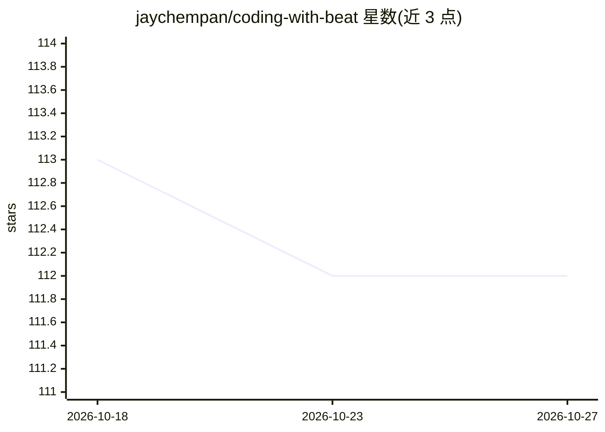

# jaychempan/coding-with-beat

⭐ 112 · Python · MIT · 推送 2026-06-30 · [GitHub](https://github.com/jaychempan/coding-with-beat) · [官网](https://codebeat.top/) · 个人维护 · 中文 README

**给终端 AI 编程用户的复古像素 DJ：终端内放歌与歌词同步**

面向 Claude Code / Codex CLI 等 AI 终端使用者的音乐伴侣：以 MCP server 提供 38 个工具，让 AI 按自然语言或 /cwb 命令搜索并播放音乐；音源支持 Apple Music（AppleScript）、本地文件（afplay）与 QQ Music（搜索+30 秒试听）。内置 CC hooks 的 Vibe 引擎随 git commit、测试失败等编码事件切换情绪，像素 DJ 角色与状态栏联动显示曲目、LRC 歌词与番茄钟；cwb CLI 可独立使用。限制：QQ Music 无官方 API 仅能试听，Apple Music 完整播放需订阅。macOS 上以 LaunchAgent 启动本地 HTTP MCP server，并支持 SSH 反向端口转发远程控制。

## 筛选速览

| 维度 | 判定 | 备注 |
|---|---|---|
| AI 角色 | `ai-enhanced` | 去掉 AI 部分产品仍成立 |
| 许可风险 | `permissive` | MIT |
| 部署形态 | `None` |  |
| 模型依赖 | — | README 未给出锁定关系 |
| 硬件要求 | — | 无带数字的原话,不猜 |
| 安装摩擦 | `low` | 无编译、无系统依赖或容器化 |
| 成熟度 | `idea` | |

## 能力要点

- MCP server 提供 38 个工具，AI 按自然语言/场景播放音乐
- Vibe 引擎通过 CC hooks 随编码事件（commit/测试失败）切换情绪反应
- 音源支持 Apple Music / 本地文件 / QQ Music（30 秒试听）
- 状态栏与 cwb CLI 可接入 tmux、Neovim 等第三方状态栏

## 适用场景

- 在终端 vibecoding 时让 AI 放背景音乐并同步看歌词
- 让 AI 根据心情/场景（lofi、专注、爵士等）选歌，commit 成功或测试失败时获得互动反馈
- 在远程服务器上通过 SSH 隧道控制本地 Mac 的 Apple Music

## 场景标签

 · 领域:开发者工具/音乐娱乐

## 证据(README 行号)

> L66: - **MCP server** — 38 tools so you can tell your AI "play some lofi", "skip this", "what's playing" and it just wor
> L86: - **DJ Buddy** — A headphones-wearing pixel character that reacts to your coding state. Tests failing? It panics wi
> L273: > QQ Music has no official API. Search metadata comes from public endpoints; audio is played as 30-second preview 

## 星数曲线

2026-10-18 113 → 2026-10-27 112（-1）

---
*卡片 v1 · prompt 1.4 · 生成 2026-10-23 · 置信度 high · 依据 README sha `064cd7c5ce7c` · [字段定义](../../DATASET.md)*
