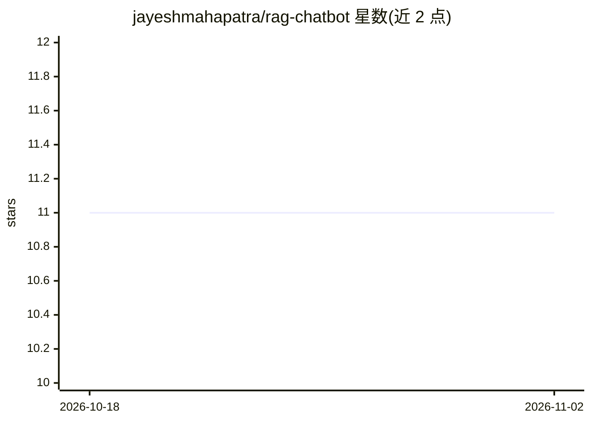

# jayeshmahapatra/rag-chatbot

⭐ 11 · Python · MIT · 推送 2026-06-05 · [GitHub](https://github.com/jayeshmahapatra/rag-chatbot) · [官网](https://chat.jayeshdev.com/) · 个人维护

**为个人技术博客搭建的 RAG 问答聊天机器人**

基于 chat-langchain 修改的 RAG 聊天机器人，前后端分离：后端用 Langchain + FastAPI/LangServe 提供检索增强生成逻辑，Chroma 作为自托管向量库，Together AI 提供 msmarco-bert 嵌入与 Mixtral 回答生成，Langfuse 做监控；前端为 NextJS/Chakra UI。部署方式为多阶段 Docker 镜像加 docker compose 编排，需配置环境变量文件并运行 ingestion_pipeline.py 填充向量库。原在线站点已下线。

## 筛选速览

| 维度 | 判定 | 备注 |
|---|---|---|
| AI 角色 | `ai-native` | 本体是模型或模型工具 |
| 许可风险 | `permissive` | MIT |
| 部署形态 | `self-host` | docker 或自建部署 |
| 模型依赖 | locked-api |  |
| 硬件要求 | — | 无带数字的原话,不猜 |
| 安装摩擦 | `low` | 无编译、无系统依赖或容器化 |
| 成熟度 | — | 结构信号不足 |

## 能力要点

- 前后端分离：Langchain/FastAPI/LangServe 后端 + NextJS/Chakra UI 前端
- 自托管 Chroma 向量数据库，ingestion_pipeline.py 脚本填充数据
- Together AI 嵌入（msmarco-bert-base-dot-v5）与生成（Mixtral-Instruct-v0.1）
- 多阶段 Docker 构建，docker compose 编排部署

## 适用场景

- 给自己的博客或文档站搭建可问答的聊天机器人
- 参考 RAG 全栈（检索、生成、监控、部署）实现的学习样本

## 场景标签

`RAG` `聊天机器人` · 领域:对话与助手

## 证据(README 行号)

> L2: This repo containes codebase for a Retrieval-Augmented Generation (RAG) based chatbot at ~~`https://chat.jayeshdev.c
> L16:  - Langchain for Retrieval-Augmented Generation (RAG) logic
> L31:  - use Together AI for embedding (msmarco-bert-base-dot-v5) and answer generation (Mixtral-Instruct-v0.1).

## 星数曲线

2026-10-18 11 → 2026-11-02 11（+0）

---
*卡片 v1 · prompt 1.4 · 生成 2026-11-02 · 置信度 high · 依据 README sha `46cbb32fb965` · [字段定义](../../DATASET.md)*
