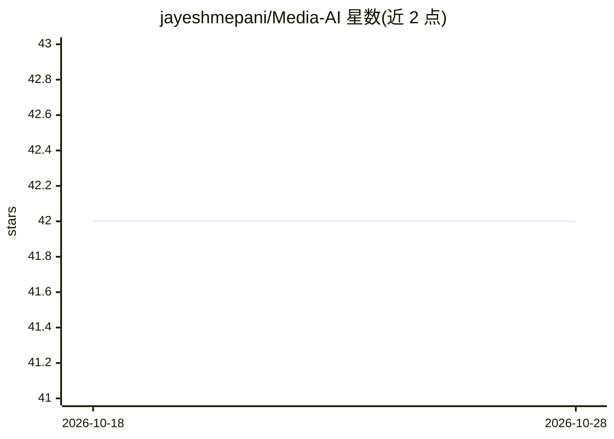

# jayeshmepani/Media-AI

⭐ 42 · CC0-1.0 · 推送 2026-08-15 · [GitHub](https://github.com/jayeshmepani/Media-AI) · 个人维护

**AI 媒体生成工具策展清单：198+ 条图像/视频/音频/3D 平台条目**

覆盖图像、视频、音频、语音、3D、增强与多模态平台的 AI 生成工具编目清单，共 198+ 条条目与引用。编者声明对快照内容按第一方来源（官方发布说明、模型页、变更日志）做过核验，标注 GA/Preview/Announced/Legacy/Unverified 状态标签，并移除或降级缺乏第一方支持的声明。条目按图像生成与编辑等类别组织，含商业平台与开权重模型（Stable Diffusion、FLUX.2、Ideogram 4.0），面向需要选型参考的创作与开发读者。

## 筛选速览

| 维度 | 判定 | 备注 |
|---|---|---|
| AI 角色 | `ai-knowledge` | 知识聚合/清单类 |
| 许可风险 | `viral` | CC0-1.0 |
| 部署形态 | `None` |  |
| 模型依赖 | — | README 未给出锁定关系 |
| 硬件要求 | — | 无带数字的原话,不猜 |
| 安装摩擦 | `low` | 无编译、无系统依赖或容器化 |
| 成熟度 | — | 结构信号不足 |

## 能力要点

- 198+ 条目录条目覆盖图像/视频/音频/3D/多模态生成平台
- GA/Preview/Announced/Legacy/Unverified 五级状态标签体系
- 按第一方来源核验，移除无佐证的排名、'最佳'声明与固定定价

## 适用场景

- 为图像/视频/音频创作项目筛选生成工具
- 查找开权重、可本地部署的生成模型（Stable Diffusion、FLUX.2 等）
- 跟踪各平台当前模型版本与弃用状态

## 场景标签

`精选清单` `图像生成` · 领域:内容生成

## 证据(README 行号)

> L5: **Coverage:** 198+ catalogue entries/references across image, video, audio, voice, 3D, enhancement, and multimodal p
> L9: > **Status labels:** **GA** = generally available; **Preview/Beta** = subject to change; **Announced** = not necessa
> L62: ## 🖼️ IMAGE GENERATION & EDITING

## 星数曲线

2026-10-18 42 → 2026-10-28 42（+0）

---
*卡片 v1 · prompt 1.4 · 生成 2026-10-25 · 置信度 high · 依据 README sha `2a854689f4fb` · [字段定义](../../DATASET.md)*
