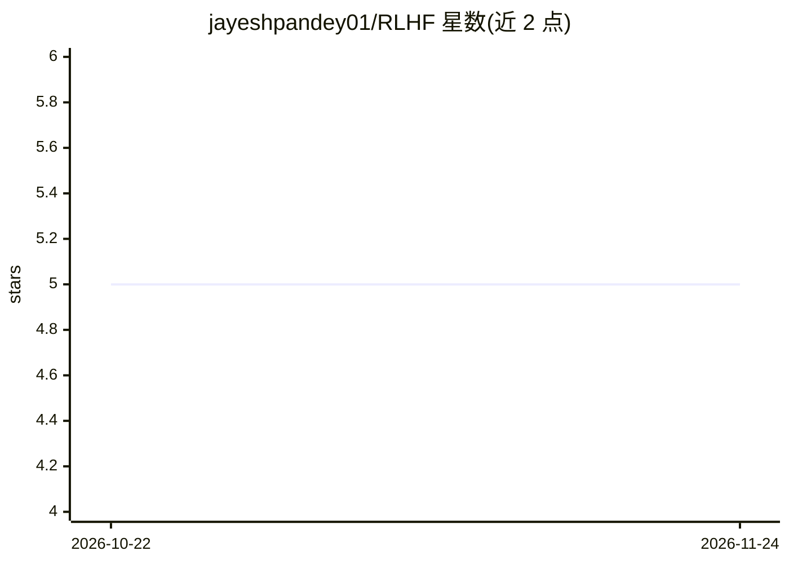

# jayeshpandey01/RLHF

⭐ — · [GitHub]() · 个人维护

**开发者的大模型持续后训练闭环原型：采集、微调、门控发布**

以 PyTorch 实现的自主持续后训练系统原型，闭环覆盖网页抓取与 MinHash 去重、BM25+稠密检索融合、句子级引用核验、LoRA 持续 SFT、DPO/PPO/GRPO 偏好对齐，以及基于配对 Bootstrap 与 Wilcoxon/McNemar 的统计发布门控，通过 FastAPI 网关提供查询与训练任务端点，checkpoint 经门控批准后热切换入 Ollama 服务并支持原子回滚。运行依赖本地 Ollama 后端（默认 qwen2.5:0.5b）与 Hugging Face 训练 worker。

## 筛选速览

| 维度 | 判定 | 备注 |
|---|---|---|
| AI 角色 | `ai-ecosystem` | LLM/agent 周边工具 |
| 许可风险 | `none` | — |
| 部署形态 | `None` |  |
| 模型依赖 | local-ok | 支持本地模型 |
| 硬件要求 | — | 无带数字的原话,不猜 |
| 安装摩擦 | `medium` | 含编译或系统依赖之一 |
| 成熟度 | — | 结构信号不足 |

## 能力要点

- LoRA SFT 与 DPO/cDPO/IPO、PPO+GAE、DeepSeek-R1 式 GRPO 对齐引擎
- BM25+稠密嵌入 RRF 融合检索与 RAG Triad 引用核验（>85% 阈值）
- 70/30 分层经验回放缓冲对抗灾难性遗忘
- 四桶统计发布门控与零停机原子回滚

## 适用场景

- 搭建网页数据驱动的持续学习 LLM 原型
- 在本地通过 API 触发 LoRA 后训练并查看门控报告
- 对候选 checkpoint 做统计显著性评估后再上线

## 场景标签

`RAG` `微调` `强化学习` `模型评测` · 领域:评测与运维

## 证据(README 行号)

> L12: An end-to-end, closed-loop system prototype for **autonomous continual post-training in Large Language Models**. Th
> L15: > **Implementation Scope**: The default FastAPI application performs live web collection, curation, persistent hybr

## 星数曲线

2026-10-22 5 → 2026-11-24 5（+0）

---
*卡片 v1 · prompt 1.4 · 生成 2026-11-21 · 置信度 high · 依据 README sha `ba02c712a0ec` · [字段定义](../../DATASET.md)*
