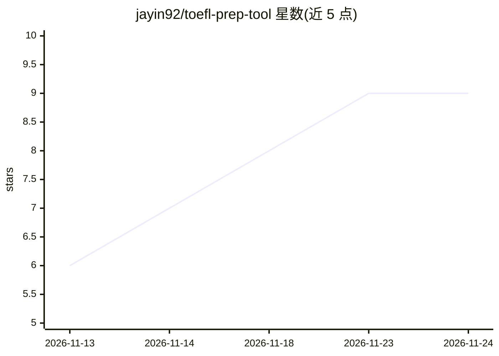

# jayin92/toefl-prep-tool

⭐ 9 · TypeScript · MIT · 推送 2026-11-13 · [GitHub](https://github.com/jayin92/toefl-prep-tool) · 个人维护 · 中文 README

**TOEFL iBT 自学者本地练习应用，四科练习与 AI 评分**

面向自修考生的本地 TOEFL iBT（2026 新制）练习应用：提供限时 Drills、考试条件 Simulations 与 Full-Test Runs，覆盖听说读写四科。Reading/Listening 在本地按答案键计分，Speaking/Writing 由双 AI Judge（Gemini 与 OpenAI）独立评分，再由 Arbiter（Claude Code 或 Codex CLI）先自评后仲裁，生成含扣分点、中文摘要与 Model Rewrite 的 Score Report，并给出 unofficial Band Estimate。运行需 Node 24、Chrome、ffmpeg，部分功能需 API key 或 CLI 登录。

## 筛选速览

| 维度 | 判定 | 备注 |
|---|---|---|
| AI 角色 | `ai-native` | 本体是模型或模型工具 |
| 许可风险 | `permissive` | MIT |
| 部署形态 | `None` |  |
| 模型依赖 | — | README 未给出锁定关系 |
| 硬件要求 | — | 无带数字的原话,不猜 |
| 安装摩擦 | `medium` | 含编译或系统依赖之一 |
| 成熟度 | — | 结构信号不足 |

## 能力要点

- Speaking/Writing 双 AI Judge 评分，Arbiter 先自评再仲裁三方分数
- Reading/Listening 计分全程本地运行、无网络调用
- 两阶段自适应 Simulation（Router Module 按得分选择第二模块难度）
- 练习数据留在本地，无账号、无托管服务器、无 analytics

## 适用场景

- 自修备考 TOEFL iBT 2026 新制并获取针对性反馈
- 考前在本地做四科完整模拟并估算分数
- 查看自己作文/口语的扣分点与改写示例

## 场景标签

 · 领域:教育/语言学习工具

## 证据(README 行号)

> L5: A practice app for the TOEFL iBT® test in the format ETS introduced in January 2026. It runs on your
> L114: - **Speaking and Writing** go to two independent AI Judges, Gemini and OpenAI. Speaking Judges hear
> L115:  your recording, not just a transcript. An Arbiter, Claude or Codex, then commits its own score

## 星数曲线

2026-11-13 6 → 2026-11-24 9（+3）

---
*卡片 v1 · prompt 1.4 · 生成 2026-11-20 · 置信度 high · 依据 README sha `358da482a2c7` · [字段定义](../../DATASET.md)*
