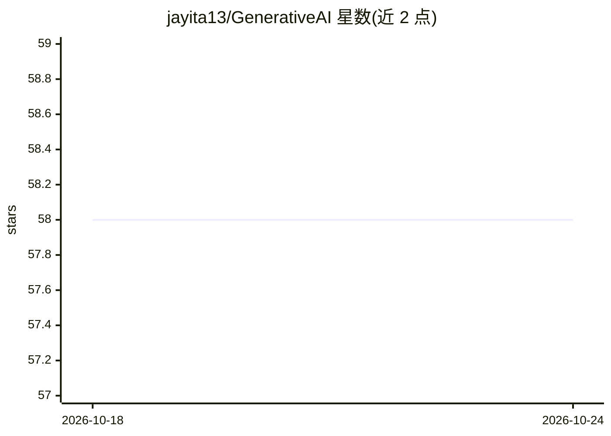

# jayita13/GenerativeAI

⭐ 58 · Jupyter Notebook · 推送 2026-03-12 · [GitHub](https://github.com/jayita13/GenerativeAI) · 个人维护

**生成式 AI 实验仓库：LLM/RAG/Agent 等方向的实验集**

个人实验性质的仓库，README 仅列出实验方向清单：LLM、LangChain 与 LlamaIndex 框架、向量数据库、RAG 系统、评测监控与可观测性、AI Agent、Graph RAG、Hybrid RAG、性能优化、生产化与用例等。未提供安装命令、运行说明或具体代码路径描述，内容为方向罗列。适合作为个人 GenAI 实验记录查看。

## 筛选速览

| 维度 | 判定 | 备注 |
|---|---|---|
| AI 角色 | `ai-knowledge` | 知识聚合/清单类 |
| 许可风险 | `none` | — |
| 部署形态 | `None` |  |
| 模型依赖 | — | README 未给出锁定关系 |
| 硬件要求 | — | 无带数字的原话,不猜 |
| 安装摩擦 | `low` | 无编译、无系统依赖或容器化 |
| 成熟度 | — | 结构信号不足 |

## 能力要点

- 覆盖 LLM、RAG、Graph RAG、Hybrid RAG 等实验方向
- 涉及评测、监控与可观测性
- 使用 LangChain 与 LlamaIndex 框架

## 适用场景

- 查看个人生成式 AI 各方向的实验记录
- 参考 RAG 与 Agent 相关实验方向

## 场景标签

 · 领域:生成式 AI 实验

## 证据(README 行号)

> L5: - Frameworks - Langchain / Llamaindex
> L7: - RAG systems

## 星数曲线

2026-10-18 58 → 2026-10-24 58（+0）

---
*卡片 v1 · prompt 1.4 · 生成 2026-10-24 · 置信度 low · 依据 README sha `b62de8003936` · [字段定义](../../DATASET.md)*
