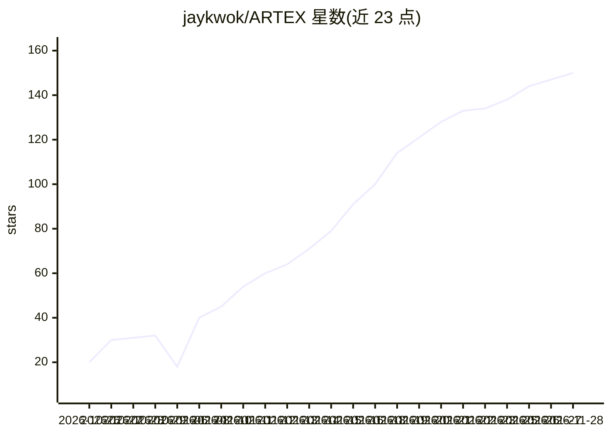

# jaykwok/ARTEX

⭐ 150 · Go · AGPL-3.0 · 推送 2026-11-16 · [GitHub](https://github.com/jaykwok/ARTEX) · 个人维护 · 中文 README

**给渗透测试者的 LLM 多 agent 自主渗透测试系统**

Go 单体后端内嵌 Next.js 前端的 AI 自主渗透测试系统，本仓库为原版 Autumn-27/ARTEX v0.3.15 的自维护修改版，v1.0.0 起独立发布。核心机制包括探索图与资产图双图架构、planner 多轮共享 todolist、worker 间执行过程检索、人在环路审批门与记录型 MITM 代理。业务库改为内嵌 SQLite，无需安装数据库服务；运行需配置 LLM API Key（Anthropic 或 OpenAI）。支持页面一键更新与自动回滚。原版使用 PostgreSQL，本版不提供旧数据迁移。

## 筛选速览

| 维度 | 判定 | 备注 |
|---|---|---|
| AI 角色 | `ai-native` | 本体是模型或模型工具 |
| 许可风险 | `viral` | AGPL-3.0 |
| 部署形态 | `self-host` | docker 或自建部署 |
| 模型依赖 | — | README 未给出锁定关系 |
| 硬件要求 | — | 无带数字的原话,不猜 |
| 安装摩擦 | `low` | 无编译、无系统依赖或容器化 |
| 成熟度 | — | 结构信号不足 |

## 能力要点

- 双图架构：全局共享资产图 + 每任务独立探索图，锚点相连支撑覆盖图
- planner 多轮共享 todolist 与 worker 跨 work 过程检索机制
- SQLite 内嵌单二进制，提供预编译包/Docker/源码等多种部署方式
- 页面一键更新，含 SHA256 校验、冒烟测试与失败自动回滚

## 适用场景

- 对授权目标发起自主多步渗透探索并留存血缘链路
- 通过 ScopeSentry 同步资产后由 agent 探索测试
- 漏洞修复后发起独立复测 agent 会话并自动更新处置状态

## 场景标签

`多智能体` `网络安全` · 领域:Agent 开发

## 证据(README 行号)

> L3: AI 自主渗透测试系统（Go 后端 + Next.js 前端）
> L302: ARTEX 是一套 **LLM 多 agent 驱动的自主渗透系统**：Go 单体后端（内嵌 Next.js 前端）+ SQLite，agent 能力由 `norma` SDK 提供（`agentcore` / `tool` /
> L327: - **探索图（Exploration Graph，每任务独立）**：一次任务的“思考与推进”过程。节点为 `goal（目标）/ intent（意图）/ fact（事实）/ finding（漏洞）/ hint（提示）`，靠 `s

## 星数曲线

2026-10-26 20 → 2026-11-28 150（+130）

---
*卡片 v1 · prompt 1.4 · 生成 2026-11-27 · 置信度 high · 依据 README sha `4f07214f0cdd` · [字段定义](../../DATASET.md)*
