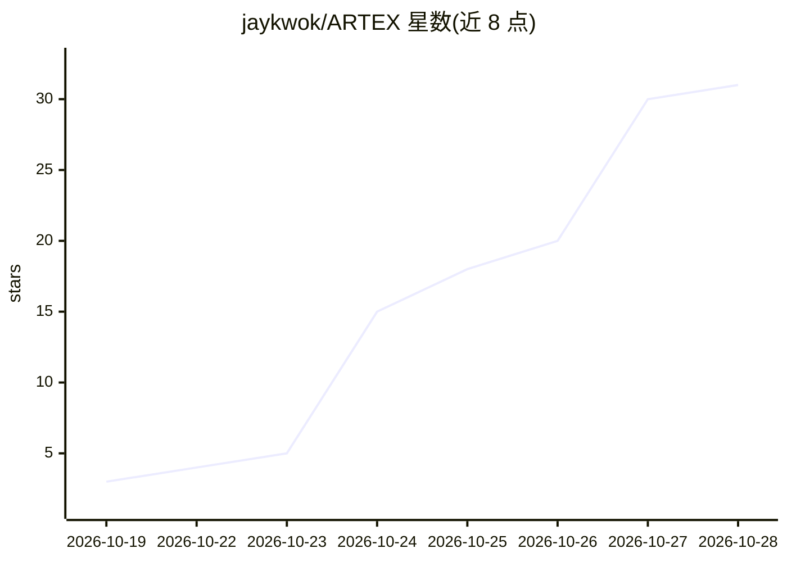

# jaykwok/ARTEX

⭐ 31 · Go · AGPL-3.0 · 推送 2026-10-23 · [GitHub](https://github.com/jaykwok/ARTEX) · 个人维护 · 中文 README

**LLM 多 agent 驱动的自主渗透测试系统（Go+Next.js）**

基于原版 Autumn-27/ARTEX v0.3.15（e6ec569）的自维护修改版。Go 单体后端内嵌 Next.js 前端与 SQLite，由 planner/worker 多 agent 通过双图架构（全局共享资产图 + 每任务探索图）自主执行渗透任务，含探索链路可视化、流量录制、人在环路对话、拦截审批与漏洞复测。v1.0.0 起的修改包括：数据库改内嵌 SQLite（免装 PostgreSQL）、移除资产拦截功能、移除登录前免责声明弹窗等；不提供原 PostgreSQL 数据迁移。探索需配置 ANTHROPIC_API_KEY 或 OPENAI_API_KEY。提供一键脚本、Docker Compose、预编译二进制、源码编译四种安装方式。

## 筛选速览

| 维度 | 判定 | 备注 |
|---|---|---|
| AI 角色 | `ai-native` | 本体是模型或模型工具 |
| 许可风险 | `viral` | AGPL-3.0 |
| 部署形态 | `self-host` | docker 或自建部署 |
| 模型依赖 | — | README 未给出锁定关系 |
| 硬件要求 | — | 无带数字的原话,不猜 |
| 安装摩擦 | `low` | 无编译、无系统依赖或容器化 |
| 成熟度 | — | 结构信号不足 |

## 能力要点

- 双图架构：全局资产图与每任务探索图经锚点相连，支撑资产覆盖度展示
- planner 共享 todolist 按依赖逐步派发多步攻击链意图
- worker 间过程级信息交换（跨 work 检索执行过程）
- 数据库内嵌 SQLite，无需安装数据库服务，编译为单二进制

## 适用场景

- 授权范围内对目标资产进行多 agent 自动化渗透测试
- 跟踪任务探索链路、资产覆盖度与漏洞发现过程
- 对已发现漏洞发起独立 Agent 会话手动复测
- 从 ScopeSentry 同步资产数据进入资产图供 agent 探索

## 场景标签

`多智能体` `网络安全` · 领域:Agent 开发

## 证据(README 行号)

> L3: AI 自主渗透测试系统（Go 后端 + Next.js 前端）
> L301: ARTEX 是一套 **LLM 多 agent 驱动的自主渗透系统**：Go 单体后端（内嵌 Next.js 前端）+ SQLite，agent 能力由 `norma` SDK 提供（`agentcore` / `tool` /

## 星数曲线

2026-10-19 3 → 2026-10-28 31（+28）

---
*卡片 v1 · prompt 1.4 · 生成 2026-10-27 · 置信度 high · 依据 README sha `a6d348b0027c` · [字段定义](../../DATASET.md)*
