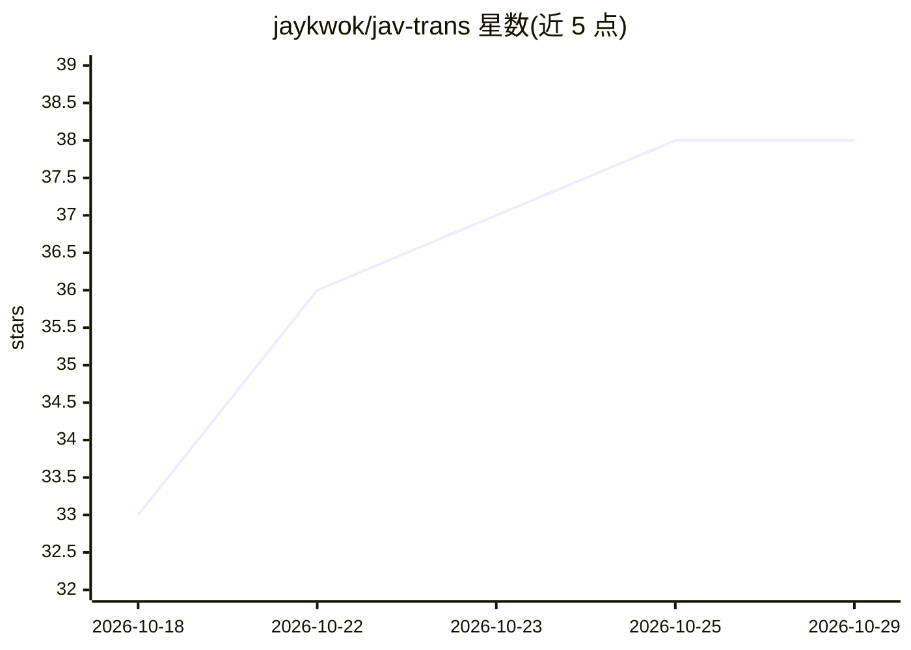

# jaykwok/jav-trans

⭐ 38 · Python · MIT · 推送 2026-10-14 · [GitHub](https://github.com/jaykwok/jav-trans) · [官网](https://github.com/jaykwok/jav-trans/releases/latest) · 个人维护 · 中文 README

**Windows 用户为日语视频本地生成日中双语 SRT 字幕**

面向 Windows 10/11 + NVIDIA 显卡（≥8GB 显存）用户的本地字幕工具：选好视频后自动完成日语语音识别（必须 CUDA）、时间轴对齐、翻译与 SRT 导出。翻译可选 API（OpenAI 兼容 Responses 接口，默认 OpenRouter）或本地翻译（llama.cpp + Hy-MT2-7B Q6，字幕不出本机）。以约 100MB 的 Windows 发布包分发，运行环境与模型（识别模型约 3.9GB、翻译模型约 6.2GB）首次使用时自动下载，共需约 17GB 磁盘。输出仅日文、译文或双语字幕，可生成含复查建议的质量报告。

## 筛选速览

| 维度 | 判定 | 备注 |
|---|---|---|
| AI 角色 | `ai-native` | 本体是模型或模型工具 |
| 许可风险 | `permissive` | MIT |
| 部署形态 | `desktop` | 安装包/桌面程序 |
| 模型依赖 | local-ok | 支持本地模型 |
| 硬件要求 | — | 无带数字的原话,不猜 |
| 安装摩擦 | `medium` | 含编译或系统依赖之一 |
| 成熟度 | — | 结构信号不足 |

## 能力要点

- 本地语音识别 + 时间轴对齐 + 翻译 + SRT 导出的完整流程
- 翻译后端可选：OpenAI 兼容 API 或 llama.cpp 本地模型（Hy-MT2-7B）
- 双语字幕按 Netflix 字幕规范排版，可生成质量报告（.md）
- 识别与翻译缓存可复用，失败步骤可单独重试

## 适用场景

- 给日语视频生成中文字幕或日中双语字幕
- 视频与音频不出本机的前提下完成转录和本地翻译
- 通过质量报告定位需人工复查的译文和时间轴问题

## 场景标签

`语音识别` · 领域:感知与多模态

## 证据(README 行号)

> L3: **把 JAV 日语视频变成日文、译文或双语字幕。** 在本机控制台选好视频，程序会依次完成语音识别、时间轴对齐、翻译（可选）和字幕导出。
> L20: |显卡|NVIDIA 独立显卡，至少 **8GB 物理显存**|
> L24: 语音识别必须使用 CUDA。CUDA 不可用、驱动过旧或显存不足时，程序会直接报错，不会改用 CPU。

## 星数曲线

2026-10-18 33 → 2026-10-29 38（+5）

---
*卡片 v1 · prompt 1.4 · 生成 2026-10-25 · 置信度 mid · 依据 README sha `662aecc60d77` · [字段定义](../../DATASET.md)*
