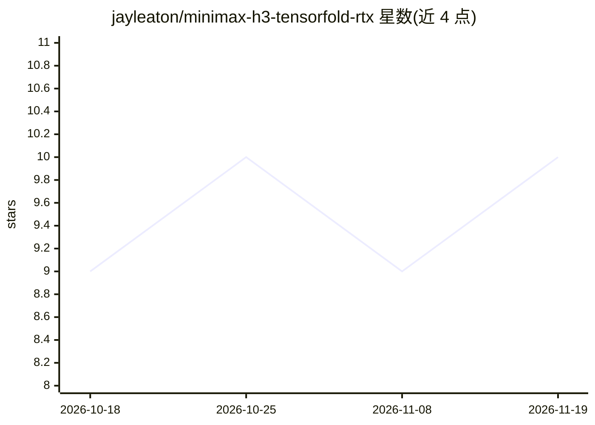

# jayleaton/minimax-h3-tensorfold-rtx

⭐ 10 · Python · Apache-2.0 · 推送 2026-10-30 · [GitHub](https://github.com/jayleaton/minimax-h3-tensorfold-rtx) · 个人维护

**在 RTX 50 系 GPU 上加速运行 MiniMax H3 视频+音频生成的 ComfyUI 加载器节点**

一个 ComfyUI 自定义节点项目：用 TensorFold 的 NVFP4 W4A4 张量核 GEMM 与 8-bit attention 替换 MiniMax H3 19B DiT 的 50 个 transformer block，其余流程（文本编码器、采样器、VAE、LoRA、稀疏注意力节点）保持不变。工作流把 `Load Diffusion Model` 换成该加载器即可使用；首次运行将权重一次性转换为 NVFP4 并缓存（每个 LoRA 集约 11 GB）。仅在 RTX 50 系 GPU、原生 Windows 环境下测量；作者标注为 Work in progress，参数与数值可能随提交变化。

## 筛选速览

| 维度 | 判定 | 备注 |
|---|---|---|
| AI 角色 | `ai-ecosystem` | LLM/agent 周边工具 |
| 许可风险 | `permissive` | Apache-2.0 |
| 部署形态 | `None` |  |
| 模型依赖 | — | README 未给出锁定关系 |
| 硬件要求 | — | 无带数字的原话,不猜 |
| 安装摩擦 | `medium` | 含编译或系统依赖之一 |
| 成熟度 | `idea` | |

## 能力要点

- NVFP4 W4A4 + INT8 attention 加速的 drop-in ComfyUI 加载器节点
- 提供 nvfp4/int8/fp8/bf16 等多种精度选项与确定性复现检查工具
- 附带基准测试、质量对比（LPIPS/DINOv2/音频距离）与 profiling 工具
- 附带文生视频+音频与图生视频的两个改版工作流模板

## 适用场景

- 在单张 RTX 50 系显卡上用 ComfyUI 更快生成 MiniMax H3 视频+音频
- 在不改动现有 ComfyUI 工作流的前提下替换加载器节点
- 对量化精度与生成质量的权衡做逐帧基准对比

## 场景标签

`视频生成` `模型量化` `模型评测` · 领域:评测与运维

## 证据(README 行号)

> L7: A faster way to run the MiniMax H3 audio-video model in ComfyUI: a drop-in loader node that runs H3's 19B-parameter
> L76: Requirements: an NVIDIA RTX 50-series GPU (compute capability 12.x; NVFP4 needs the block-scaled FP4 MMA), a recent
> L100: **3. Install the node**, either with a directory junction

## 星数曲线

2026-10-18 9 → 2026-11-19 10（+1）

---
*卡片 v1 · prompt 1.4 · 生成 2026-11-19 · 置信度 high · 依据 README sha `d3efa06654f3` · [字段定义](../../DATASET.md)*
