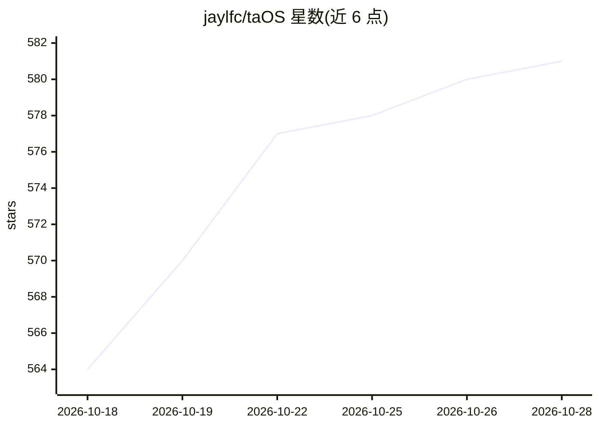

# jaylfc/taOS

⭐ 582 · Python · AGPL-3.0 · 推送 2026-10-28 · [GitHub](https://github.com/jaylfc/taOS) · [官网](https://taOS.my) · 个人维护

**自托管 AI agent 平台：在自有硬件上运行记忆、聊天、agent 与文件**

运行在用户自有硬件（旧笔记本、树莓派、Orange Pi、游戏 PC 等）上的自托管 AI agent 平台，可将多台设备组成分布式推理集群。提供浏览器 Web 桌面（43 个内置应用、109 个目录应用）、跨 17 种 agent 框架的多框架群聊、框架无关的 AI 记忆系统 taOSmd（时序知识图谱+混合检索，LongMemEval-S 端到端 97.0%）、120 个本地模型清单与 HuggingFace 16.7 万+模型检索。默认离线、数据留在本机，云模型为可选。当前为 beta，部分应用的安装清单未在真实硬件上验证。

## 筛选速览

| 维度 | 判定 | 备注 |
|---|---|---|
| AI 角色 | `ai-ecosystem` | LLM/agent 周边工具 |
| 许可风险 | `viral` | AGPL-3.0 |
| 部署形态 | `library` | 以包/库形式分发 |
| 模型依赖 | — | README 未给出锁定关系 |
| 硬件要求 | — | 无带数字的原话,不猜 |
| 安装摩擦 | `medium` | 含编译或系统依赖之一 |
| 成熟度 | `idea` | |

## 能力要点

- taOSmd 框架无关记忆系统：时序知识图谱、矛盾检测、跨编码器重排，任何框架可经 HTTP API 读写
- 多框架群聊：不同框架（SmolAgents/LangChain/OpenClaw 等）的 agent 在同一共享频道对话
- Web 桌面环境：窗口管理器、应用商店、43 个内置应用，手机/平板自动切换移动端布局并支持 PWA
- 支持 Apple Silicon (MLX)、NVIDIA、AMD、Rockchip NPU、树莓派等硬件，本地模型目录含 RK3588 NPU 与 Hailo-10H 变体

## 适用场景

- 把闲置的消费级硬件组成本地 AI 推理集群
- 在自有设备上运行带长期记忆的多框架 agent 与群聊
- 通过单一 Web 桌面管理模型、文件、MCP 插件与 agent 部署

## 场景标签

`Agent 框架` `Agent 记忆` `推理引擎` · 领域:Agent 开发

## 证据(README 行号)

> L13: Self-hosted AI agent platform that runs on whatever hardware you have. An old laptop, a Raspberry Pi, a gaming PC, 
> L17: **Framework-agnostic by design.** taOS owns everything that matters: your agent's memory, files, communication chan
> L15: A full web desktop environment with 43 bundled apps, 109 catalog apps, 47 MCP plugins, 17 agent frameworks, a curat

## 星数曲线

2026-10-18 564 → 2026-10-28 581（+17）

---
*卡片 v1 · prompt 1.4 · 生成 2026-10-21 · 置信度 mid · 依据 README sha `bfc822cde783` · [字段定义](../../DATASET.md)*
