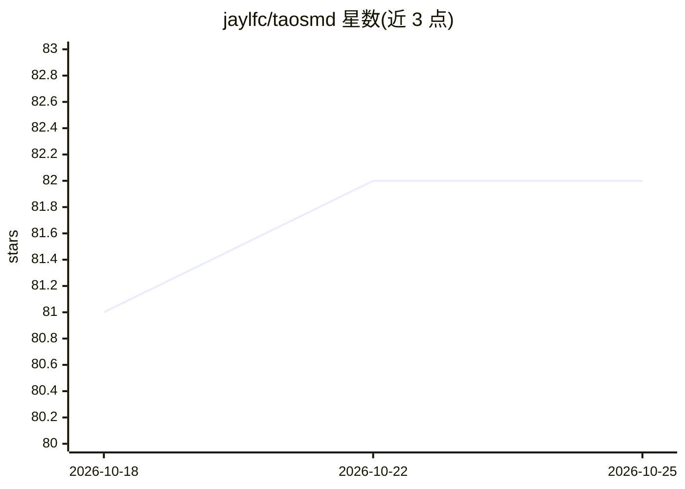

# jaylfc/taosmd

⭐ 82 · Python · AGPL-3.0 · 推送 2026-10-25 · [GitHub](https://github.com/jaylfc/taosmd) · 个人维护

**离线本地优先的框架无关 AI agent 记忆系统**

面向在低配硬件（8 GB+ RAM，如树莓派、迷你主机、旧笔记本）上离线运行 agent 的开发者，提供零损失原文归档、知识图谱与混合检索组成的持久记忆层。关键机制：对话先进入只追加、不可覆写的原文档案，检索用的记忆从档案派生；校验器将每条抽取事实对照原文核验，不支持的事实排除出召回。安装路径包括 pip、安装脚本（自动装 Ollama 与 Qwen3-4B、ONNX 嵌入模型）与源码安装，支持 MCP server，多 agent 通过 agent 标签隔离。

## 筛选速览

| 维度 | 判定 | 备注 |
|---|---|---|
| AI 角色 | `ai-ecosystem` | LLM/agent 周边工具 |
| 许可风险 | `viral` | AGPL-3.0 |
| 部署形态 | `library` | 以包/库形式分发 |
| 模型依赖 | local-ok | 支持本地模型 |
| 硬件要求 | `cpu-ok` | |
| 安装摩擦 | `low` | 无编译、无系统依赖或容器化 |
| 成熟度 | `idea` | |

## 能力要点

- 零损失 append-only 原文归档，摘要与结构叠加其上、从不覆写
- 事实校验器对照原文核验抽取结果，不支持的事实不进入召回
- 离线运行：8 GB+ RAM，CPU 可用，NPU/GPU 可选，RK3588 提供 NPU 优化模型
- 多 agent 共享服务进程、按 agent 标签行级隔离，支持 MCP server

## 适用场景

- 给我的编程 agent（Claude Code/Cursor 等）装一个本地持久记忆
- 在无外网的树莓派或迷你主机上离线运行带记忆的 agent
- 保留全部对话原文以便事后审计，不被摘要覆写

## 场景标签

`Agent 记忆` `知识图谱` · 领域:Agent 开发

## 证据(README 行号)

> L5: **Framework-agnostic AI memory system. Provable, auditable memory. 97.0% Recall@5 on LongMemEval-S.**
> L7: Provable Memory: a zero-loss archive that is never overwritten, plus a verifier that checks every extracted fact aga
> L24: Zero cloud dependencies. Zero API keys. NPU if you have one, CPU if you don't, cluster if you want the throughput.

## 星数曲线

2026-10-18 81 → 2026-10-25 82（+1）

---
*卡片 v1 · prompt 1.4 · 生成 2026-10-24 · 置信度 high · 依据 README sha `b893125d4e15` · [字段定义](../../DATASET.md)*
