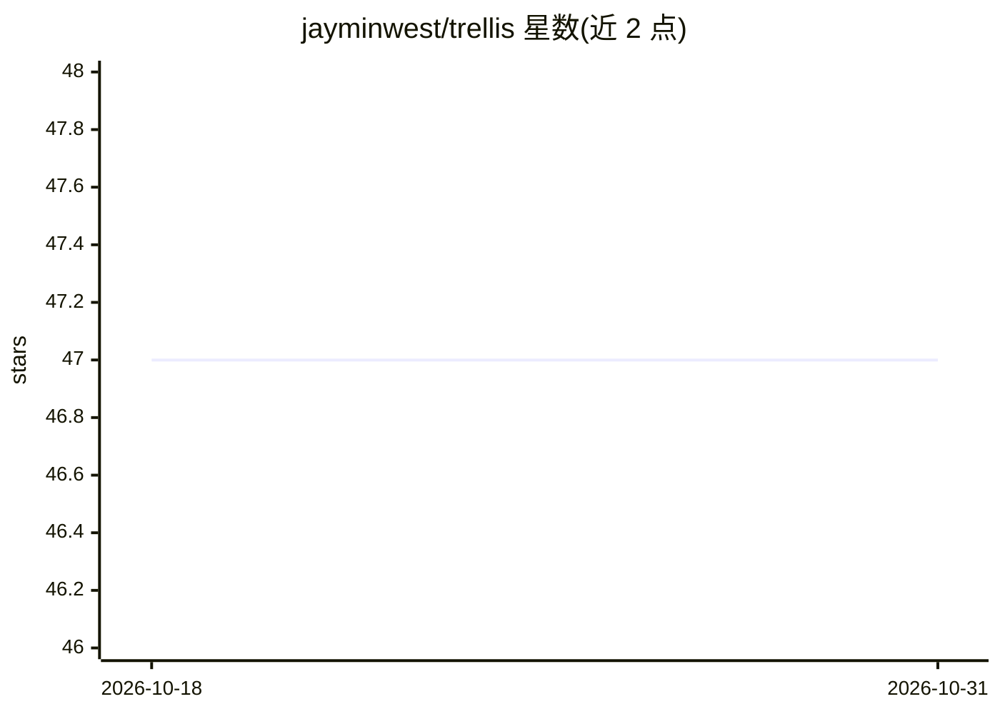

# jayminwest/trellis

⭐ 47 · TypeScript · MIT · 推送 2026-10-18 · [GitHub](https://github.com/jayminwest/trellis) · 个人维护

**面向 TypeScript 代码库的结构性债务离线度量与审计 CLI**

静态分析 TypeScript/TSX 代码库，度量函数复杂度、结构性侵蚀、重复代码与 import 循环，输出 0–100 的 sloppiness index、热点排名及可溯源的原始测量。支持基线对比、trellis.yaml 声明式策略在 CI 中拦截回归、多仓库 fleet 批量审计与本地历史记录，并提供 TypeScript SDK。另内置 cleanup 指南供 AI agent 遵循执行清理。审计完全离线运行，不需要模型调用。需 Bun 1.1+，从源码 git clone 安装；Pre-1.0 状态，评分公式为临时版本。

## 筛选速览

| 维度 | 判定 | 备注 |
|---|---|---|
| AI 角色 | `ai-ecosystem` | LLM/agent 周边工具 |
| 许可风险 | `permissive` | MIT |
| 部署形态 | `None` |  |
| 模型依赖 | — | README 未给出锁定关系 |
| 硬件要求 | — | 无带数字的原话,不猜 |
| 安装摩擦 | `low` | 无编译、无系统依赖或容器化 |
| 成熟度 | `idea` | |

## 能力要点

- 0–100 sloppiness index，每项得分可追溯到原始测量与文件位置
- 基线对比与 trellis.yaml 策略（maxIndex/regression/failOnNew）用于 CI 拦截回归
- 审计完全离线，无需模型调用、凭据或被审计项目安装依赖
- 内置 cleanup 指南，可让 AI agent 运行 trellis guide cleanup 执行清理流程

## 适用场景

- 重构前定位复杂函数、重复代码与 import 循环的堆积位置
- 在 CI 中用策略与基线拦截结构性债务回归
- 让 AI agent 按内置指南对代码库执行清理
- 跨多个仓库批量审计并跟踪代码健康历史

## 场景标签

 · 领域:开发者工具/代码质量审计

## 证据(README 行号)

> L112: Ask your agent: **Run `trellis guide cleanup` and follow it until no clearly
> L113: justified improvements remain.** The bundled guide describes the cleanup workflow;
> L10: and the measurements behind every score contribution. Audits run offline,

## 星数曲线

2026-10-18 47 → 2026-10-31 47（+0）

---
*卡片 v1 · prompt 1.4 · 生成 2026-10-25 · 置信度 mid · 依据 README sha `c2269aeada3e` · [字段定义](../../DATASET.md)*
