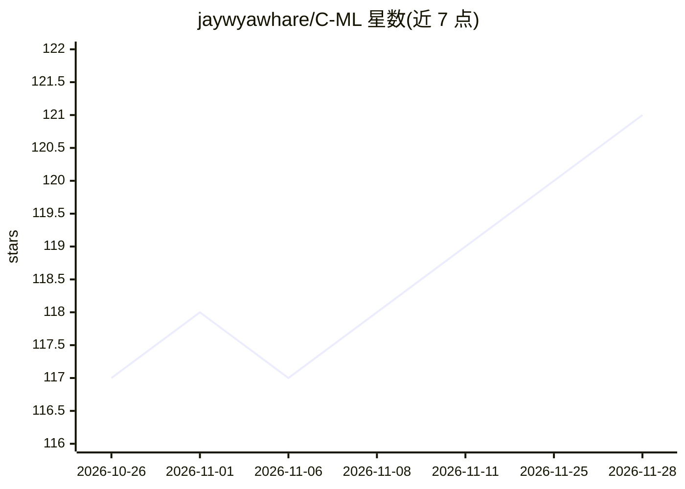

# jaywyawhare/C-ML

⭐ 121 · C · NOASSERTION · 推送 2026-11-16 · [GitHub](https://github.com/jaywyawhare/C-ML) · [官网](https://jaywyawhare.github.io/C-ML/) · 个人维护

**C11 编写的从零实现机器学习库，含 LLM 推理与 GPU 编译器**

纯 C11 实现的机器学习库，零必需依赖，覆盖张量、autograd、28 种层、11 种优化器、分布式训练；自带编译器将融合算子生成 PTX/SPIR-V/WGSL/MSL GPU 内核；支持 GGUF/ONNX/SafeTensors 模型读写与量化，含 LLaMA 7B–70B 推理路径与连续批处理服务端；提供 PyTorch 风格 Python 绑定。GPU 后端中 CUDA/ROCm 等状态为 build-verified（未经真实硬件验证），CPU 后端为 Stable。采用非商业许可。

## 筛选速览

| 维度 | 判定 | 备注 |
|---|---|---|
| AI 角色 | `ai-native` | 本体是模型或模型工具 |
| 许可风险 | `none` | NOASSERTION |
| 部署形态 | `library` | 以包/库形式分发 |
| 模型依赖 | local-ok | 支持本地模型 |
| 硬件要求 | — | 无带数字的原话,不猜 |
| 安装摩擦 | `high` | 编译与系统依赖俱全 |
| 成熟度 | — | 结构信号不足 |

## 能力要点

- 从零实现的 C11 库，零必需依赖
- 编译器将融合算子生成 PTX/SPIR-V/WGSL/MSL 内核
- GGUF/ONNX/SafeTensors 模型读写与 int8/int4/NF4 量化
- CFFI Python 绑定与 PyTorch 风格 API

## 适用场景

- 在无 Python 依赖的 C 环境中训练与推理模型
- 加载 GGUF/ONNX 模型进行 LLM 推理
- 学习张量、autograd 与 GPU 内核编译的实现

## 场景标签

`模型量化` `推理引擎` `模型训练` · 领域:训练与推理

## 证据(README 行号)

> L24: C-ML is a machine learning library written from scratch in C11. It covers
> L66: |**LLMs**|LLaMA 7B–70B · LoRA / QLoRA · Flash Attention · GQA · ALiBi · RoPE scaling · paged and sliding-window KV 

## 星数曲线

2026-10-26 117 → 2026-11-28 121（+4）

---
*卡片 v1 · prompt 1.4 · 生成 2026-11-28 · 置信度 mid · 依据 README sha `bfef68b961a8` · [字段定义](../../DATASET.md)*
