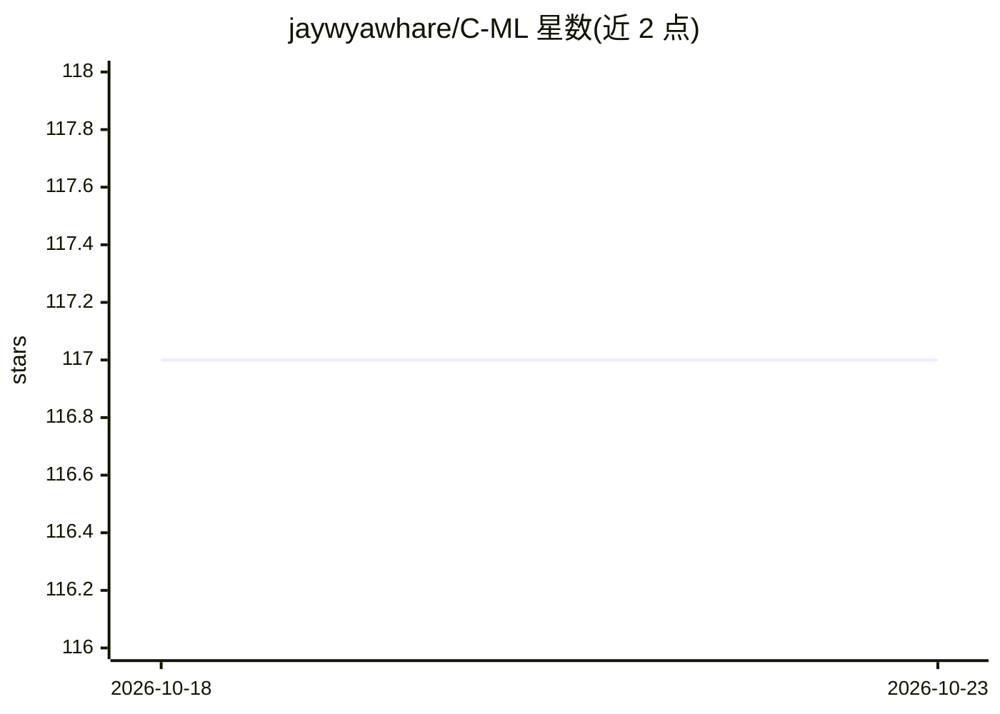

# jaywyawhare/C-ML

⭐ 117 · C · NOASSERTION · 推送 2026-10-22 · [GitHub](https://github.com/jaywyawhare/C-ML) · [官网](https://jaywyawhare.github.io/C-ML/) · 个人维护

**纯 C11 实现的机器学习库：张量、autograd、算子融合编译与 LLM 推理**

从零用 C11 编写的机器学习库，提供张量、autograd、28 种层、11 种优化器、分布式训练与 LLM 推理能力，并含算子融合编译器，可生成 C/PTX/SPIR-V/WGSL/MSL 多种 GPU 内核。支持 GGUF/ONNX/SafeTensors/.pth 模型读写与量化，提供 CFFI Python 绑定。零必需依赖，经 CMake 源码编译安装。限制：GPU 后端（CUDA/ROCm/Vulkan 等）仅为 build-verified，驱动路径未经真实硬件验证，CPU 后端为稳定默认路径。

## 筛选速览

| 维度 | 判定 | 备注 |
|---|---|---|
| AI 角色 | `ai-native` | 本体是模型或模型工具 |
| 许可风险 | `none` | NOASSERTION |
| 部署形态 | `None` |  |
| 模型依赖 | — | README 未给出锁定关系 |
| 硬件要求 | — | 无带数字的原话,不猜 |
| 安装摩擦 | `high` | 编译与系统依赖俱全 |
| 成熟度 | `idea` | |

## 能力要点

- 纯 C11 从零实现，零必需依赖，含张量与 autograd
- 算子融合编译器，代码生成覆盖 PTX/SPIR-V/WGSL/MSL 等目标
- 支持 GGUF/ONNX/SafeTensors/.pth 模型 I/O 与 int8/int4/NF4 量化
- LLM 能力含 LoRA/QLoRA、Flash Attention、speculative decoding、LLaMA 7B-70B

## 适用场景

- 在无运行时依赖的环境下用 C 训练或推理神经网络与 LLM
- 读取 GGUF/ONNX/SafeTensors 格式模型做推理或量化
- 通过 Python CFFI 绑定在 NumPy 生态中使用

## 场景标签

`微调` `模型量化` `推理引擎` · 领域:训练与推理

## 证据(README 行号)

> L9: C-ML is a from-scratch C11 ML library. Tensors, autograd, 28 layers, optimizers, a compiler that fuses ops and emits
> L33: |**LLM**|LoRA/QLoRA, Flash Attention, GQA, paged KV cache, RoPE, MoE, speculative decoding, LLaMA 7B-70B|
> L38: |**I/O**|GGUF, SafeTensors, ONNX, PyTorch .pth, int8/int4/NF4 quantization|

## 星数曲线

2026-10-18 117 → 2026-10-23 117（+0）

---
*卡片 v1 · prompt 1.4 · 生成 2026-10-23 · 置信度 high · 依据 README sha `c4c5b26d4186` · [字段定义](../../DATASET.md)*
