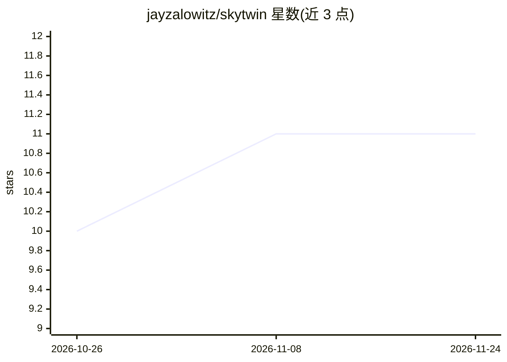

# jayzalowitz/skytwin

⭐ 11 · TypeScript · Apache-2.0 · 推送 2026-10-14 · [GitHub](https://github.com/jayzalowitz/skytwin) · [官网](https://github.com/jayzalowitz/skytwin) · 个人维护

**个人数字分身：学习你的决策偏好并代为建议与执行**

SkyTwin 是一个开源个人 AI（Apache-2.0）：构建用户的偏好、风险容忍度与决策模式的数字分身模型，生成每日简报、行动建议与解释记录。核心机制是"先问分身再问用户"——偏好带证据、置信度与可检视历史；政策引擎按信任分级（默认 observer）、消费限额、可逆性与敏感度分类约束行动；本地推理为默认，托管推理需显式选择。桌面 alpha 支持 Apple Silicon/macOS、x64 Windows 与 x86-64 Linux，可经自建 Google OAuth 客户端连接 Gmail 收件箱，或使用虚构数据样本。当前为未签名 alpha 版，Gmail 变更能力不在支持声明内。

## 筛选速览

| 维度 | 判定 | 备注 |
|---|---|---|
| AI 角色 | `ai-native` | 本体是模型或模型工具 |
| 许可风险 | `permissive` | Apache-2.0 |
| 部署形态 | `self-host` | docker 或自建部署 |
| 模型依赖 | local-ok | 支持本地模型 |
| 硬件要求 | — | 无带数字的原话,不猜 |
| 安装摩擦 | `low` | 无编译、无系统依赖或容器化 |
| 成熟度 | `idea` | |

## 能力要点

- 偏好以带置信度、证据与出处的类型化版本化结构存储，矛盾被追踪
- 政策引擎按信任分级、消费限额、可逆性检查逐域授予自主权
- 默认本地推理，不静默回退到远程托管
- 信号按作者层级加权检索，自写内容优先于广播内容

## 适用场景

- 每天浏览 AI 生成的简报并纠正它对偏好的理解
- 让分身按已学偏好处理邮件分类、日历冲突等例行决策
- 在连接真实账户前用虚构样本体验审阅-纠正流程

## 场景标签

`AI 助手` `Agent 记忆` · 领域:Agent 开发

## 证据(README 行号)

> L3: **Open-source personal AI. A digital twin that learns what matters to you, with you in control.**
> L13: That's the experience SkyTwin is building. Your **digital twin** is a growing model of your preferences, risk toler
> L33: - **Keep your choices yours.** Local reasoning is the default and does not silently fall back to a remote provider.

## 星数曲线

2026-10-26 10 → 2026-11-24 11（+1）

---
*卡片 v1 · prompt 1.4 · 生成 2026-11-18 · 置信度 mid · 依据 README sha `3dea3ceedb9b` · [字段定义](../../DATASET.md)*
