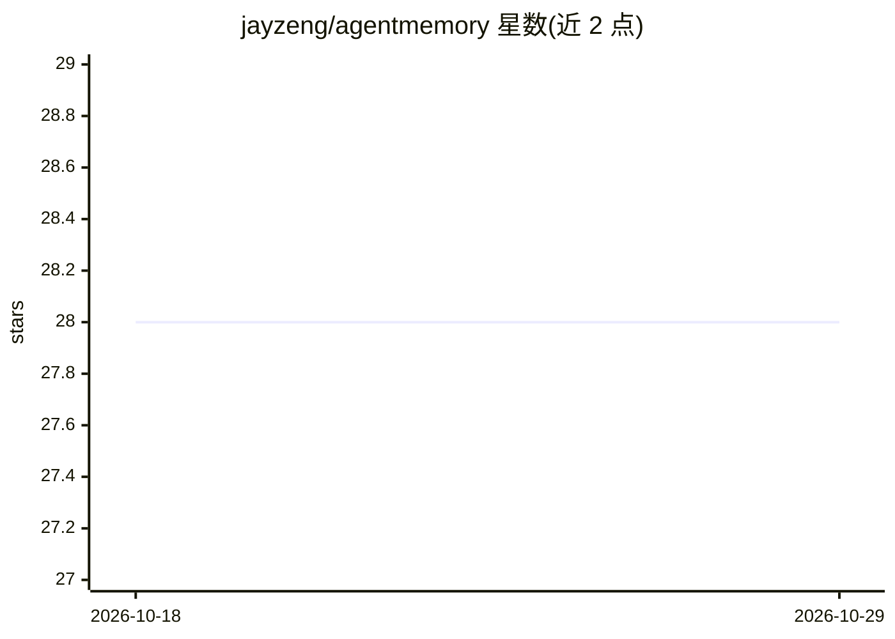

# jayzeng/agentmemory

⭐ 28 · TypeScript · MIT · 推送 2026-09-28 · [GitHub](https://github.com/jayzeng/agentmemory) · [官网](https://jayzeng.github.io/agentmemory/) · 个人维护

**面向编码 agent 的本地持久记忆层（Markdown 存储 + MCP 服务）**

为编码 agent（Claude Code、OpenAI Codex、Cursor 等）提供本地优先的持久记忆层：以纯 Markdown 文件存储持久记忆，维护每日工作日志与草稿板，默认存放于 ~/.agent-memory，可设 AGENT_MEMORY_DIR 更改。提供 agent-memory CLI 与基于 stdio 的 MCP 服务器（JSON-RPC 2.0，暴露五个工具），供任意 MCP 客户端调用。可选接入 qmd 做本地语义检索，无 qmd 时基础读写仍可用；写入前对常见凭据形态做脱敏。不依赖账户、远程服务或专有运行时。MIT 许可。

## 筛选速览

| 维度 | 判定 | 备注 |
|---|---|---|
| AI 角色 | `ai-ecosystem` | LLM/agent 周边工具 |
| 许可风险 | `permissive` | MIT |
| 部署形态 | `library` | 以包/库形式分发 |
| 模型依赖 | — | README 未给出锁定关系 |
| 硬件要求 | — | 无带数字的原话,不猜 |
| 安装摩擦 | `low` | 无编译、无系统依赖或容器化 |
| 成熟度 | — | 结构信号不足 |

## 能力要点

- 记忆以纯 Markdown 文件存储于本地 ~/.agent-memory，可用普通工具查看/备份
- MCP 服务器模式（stdio、JSON-RPC 2.0）暴露五个工具，与同名 CLI 命令逻辑一致
- 写入或注入前对常见凭据形态自动脱敏
- 可选 qmd 本地语义搜索，缺失时基础读写仍可用

## 适用场景

- 让不同编码 agent 环境共享同一份本地记忆
- 通过 MCP 客户端直接调用记忆的读写与搜索工具
- 用每日日志与草稿板记录工作过程，事后用 context 查询既往决策

## 场景标签

`Agent 记忆` · 领域:Agent 开发

## 证据(README 行号)

> L3: AgentMemory is a local-first, MIT-licensed memory layer for coding agents. It stores durable memory as plain Markdow
> L30: ## MCP server (`agent-memory serve --mcp`)

## 星数曲线

2026-10-18 28 → 2026-10-29 28（+0）

---
*卡片 v1 · prompt 1.4 · 生成 2026-10-26 · 置信度 high · 依据 README sha `d1cc117e90b8` · [字段定义](../../DATASET.md)*
