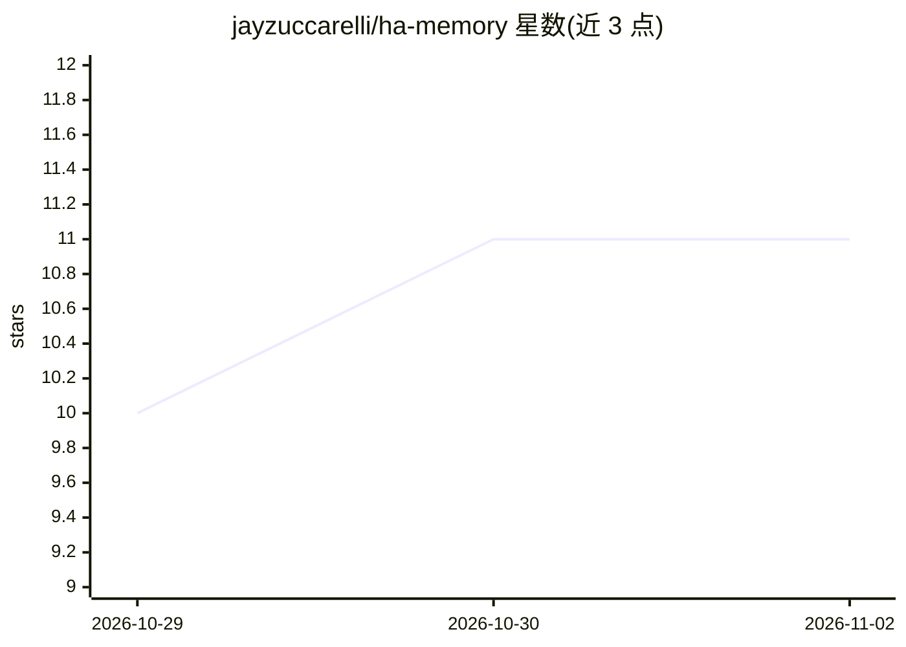

# jayzuccarelli/ha-memory

⭐ 11 · Python · MIT · 推送 2026-10-27 · [GitHub](https://github.com/jayzuccarelli/ha-memory) · 个人维护

**Home Assistant Assist 的长期记忆集成，以 markdown 存储**

面向 Home Assistant 用户的自定义集成：为 Assist 的 AI 对话代理提供跨会话记忆。以原生 LLM API 注册，向代理提供 memory_save/memory_read/memory_delete 三个工具，并在每次请求的系统提示中加入自动维护的 MEMORY.md 索引；每条记忆是一个可读可编辑的 markdown 文件，分 user/feedback/project/reference/vocabulary 五类。已测试 Claude、OpenAI、Gemini 等代理；也可通过 memory.save 等服务在自动化中调用。官方定位适合数十条记忆规模，未使用向量数据库。

## 筛选速览

| 维度 | 判定 | 备注 |
|---|---|---|
| AI 角色 | `ai-ecosystem` | LLM/agent 周边工具 |
| 许可风险 | `permissive` | MIT |
| 部署形态 | `None` |  |
| 模型依赖 | locked-api |  |
| 硬件要求 | — | 无带数字的原话,不猜 |
| 安装摩擦 | `low` | 无编译、无系统依赖或容器化 |
| 成熟度 | — | 结构信号不足 |

## 能力要点

- 注册为原生 Home Assistant LLM API，提供三个记忆工具
- 每条记忆一个 markdown 文件，任意文本编辑器可读改
- MEMORY.md 索引常驻系统提示，按需读取完整文件
- 支持 user/feedback/project/reference/vocabulary 五类记忆

## 适用场景

- 让家里语音助手记住宠物名、家庭成员等日常事实
- 让助手记住我的称呼偏好和行为反馈
- 在自动化脚本中读写记忆条目

## 场景标签

`Agent 记忆` · 领域:Agent 开发

## 证据(README 行号)

> L13: Works with Claude, OpenAI, Gemini, and other AI agents that use Home Assistant's built-in AI tools. Memories are pl
> L53: Memory registers as a native Home Assistant LLM API. When ticked, your agent gets:
> L55: - Three tools: `memory_save`, `memory_read`, `memory_delete`

## 星数曲线

2026-10-29 10 → 2026-11-02 11（+1）

---
*卡片 v1 · prompt 1.4 · 生成 2026-11-02 · 置信度 high · 依据 README sha `e4ff7b0c8ea0` · [字段定义](../../DATASET.md)*
