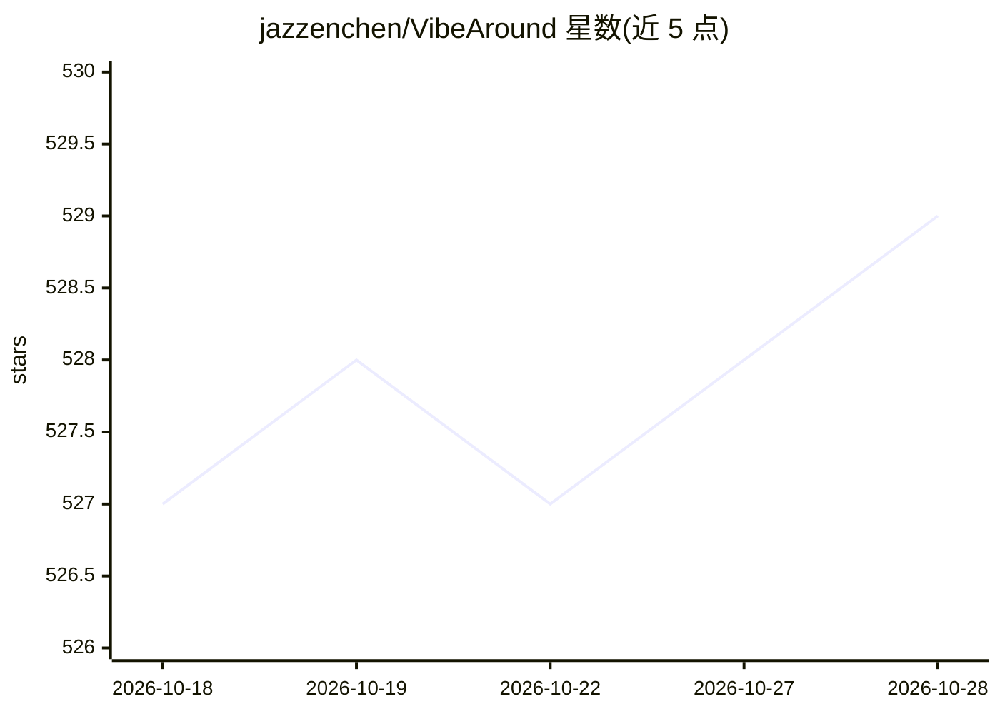

# jazzenchen/VibeAround

⭐ 530 · Rust · MIT · 推送 2026-09-05 · [GitHub](https://github.com/jazzenchen/VibeAround) · [官网](https://vibearound.ai/) · 个人维护 · 中文 README

**AI 编码代理统一启动与远程接入中枢：多代理、API 桥接、跨端续会**

桌面应用加 CLI 的 AI 编码代理管理中心：从单一 UI 启动 Claude Code、Codex CLI、Gemini CLI 等代理与桌面应用；本地 API 桥接在 OpenAI Responses/Chat Completions、Anthropic Messages、Gemini 四种 API 形态间转换，内置 DeepSeek、DashScope、Kimi、GLM 等厂商预设；可将本地代理暴露为 OpenAI/Anthropic 兼容端点用于测试。另提供主机侧网页搜索（Exa/Tavily/Grok/Brave）、IM 续会（飞书/Discord/Slack 等）、Web Terminal 与远程预览，执行保留在本机。面向使用多种编码代理的开发者。

## 筛选速览

| 维度 | 判定 | 备注 |
|---|---|---|
| AI 角色 | `ai-ecosystem` | LLM/agent 周边工具 |
| 许可风险 | `permissive` | MIT |
| 部署形态 | `desktop` | 安装包/桌面程序 |
| 模型依赖 | locked-api |  |
| 硬件要求 | — | 无带数字的原话,不猜 |
| 安装摩擦 | `low` | 无编译、无系统依赖或容器化 |
| 成熟度 | — | 结构信号不足 |

## 能力要点

- 本地 API 桥接转换 OpenAI/Anthropic/Gemini 四种 API 形态，内置十余家厂商预设
- 将本地编码代理暴露为 OpenAI/Anthropic 兼容 API 端点用于开发测试
- 通过 /pickup 命令在飞书/Lark、Discord、Slack 等 IM 中续接同一会话
- 主机侧 va-search-tool 网页搜索，提供商无原生搜索时补齐

## 适用场景

- 同时使用多个 AI 编码代理，统一选择模型、端点与工作区启动
- 让代理与任意模型提供商搭配，跨 API 协议互转
- 在手机 IM 或浏览器里远程续接本机的编码会话

## 场景标签

`模型网关` · 领域:Agent 开发

## 证据(README 行号)

> L17: - Work with the coding agents you already use, including Claude Code, Codex CLI, Gemini CLI, Pi, OpenCode, Claude D
> L69: Use more model providers with the AI agents you prefer. Save provider keys, base URLs, models, and aliases as profi
> L71: ```text

## 星数曲线



2026-10-18 527 → 2026-10-28 529（+2）


---
*卡片 v1 · prompt 1.4 · 生成 2026-10-21 · 置信度 high · 依据 README sha `07e024a3eeaa` · [字段定义](../../DATASET.md)*
