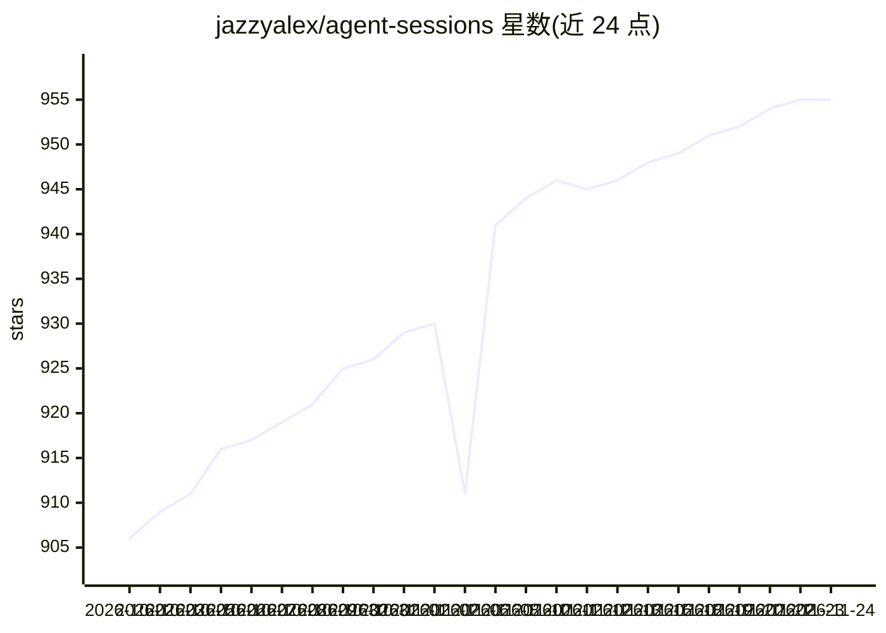

# jazzyalex/agent-sessions

⭐ 955 · Swift · MIT · 推送 2026-11-19 · [GitHub](https://github.com/jazzyalex/agent-sessions) · [官网](https://jazzyalex.github.io/agent-sessions/?campaign=github&ref=about-sidebar) · 个人维护

**macOS 本地浏览/搜索/恢复 AI 编码 agent 会话历史的工具**

本地优先的 macOS 应用，聚合 16 个 AI 编码 agent（Codex、Claude Code、Cursor、Copilot CLI、OpenCode、Cline 等）的本地会话历史：跨来源搜索提示、回复、工具调用与错误，读取会话转录与图片输出，对支持的 CLI 会话生成恢复命令并在 Terminal.app/iTerm2/Warp/Ghostty/Macterm 中打开。内置 Quota Meter 按会话追踪 Codex 与 Claude 的 5 小时/周额度消耗及 token/成本速率。索引与数据全部留在本地，无遥测。通过 Homebrew cask 分发。

## 筛选速览

| 维度 | 判定 | 备注 |
|---|---|---|
| AI 角色 | `ai-enhanced` | 去掉 AI 部分产品仍成立 |
| 许可风险 | `permissive` | MIT |
| 部署形态 | `desktop` | 安装包/桌面程序 |
| 模型依赖 | — | README 未给出锁定关系 |
| 硬件要求 | — | 无带数字的原话,不猜 |
| 安装摩擦 | `low` | 无编译、无系统依赖或容器化 |
| 成熟度 | — | 结构信号不足 |

## 能力要点

- 16 个本地 agent 会话来源的统一浏览与搜索
- 受支持的 CLI 会话可在多种终端中恢复
- Quota Meter 按会话追踪 Codex/Claude/OpenCode 额度与成本
- 本地索引，不上传会话历史，无遥测

## 适用场景

- 找回之前某次 AI 编码会话的提示词与工具调用记录
- 查看哪个会话在消耗 Codex/Claude 配额
- 在终端里接着上次的 agent 会话继续工作

## 场景标签

 · 领域:开发者工具/AI 编码辅助

## 证据(README 行号)

> L7: Search local conversations from Codex, Claude Code, Cursor, and **13 other coding agents** in one Mac app. Read the 
> L9: Open source. Your session history stays on your Mac. No telemetry.
> L122: The current source registry contains 16 active agent formats plus legacy Droid sessions. Agent Sessions 5.6 adds S

## 星数曲线

2026-10-22 906 → 2026-11-24 955（+49）

---
*卡片 v1 · prompt 1.4 · 生成 2026-11-24 · 置信度 high · 依据 README sha `b4d7982a2bfe` · [字段定义](../../DATASET.md)*
