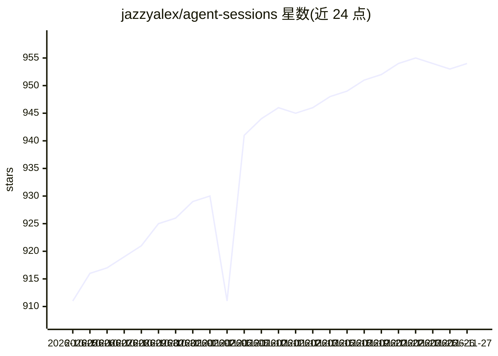

# jazzyalex/agent-sessions

⭐ 954 · Swift · MIT · 推送 2026-11-25 · [GitHub](https://github.com/jazzyalex/agent-sessions) · [官网](https://jazzyalex.github.io/agent-sessions/?campaign=github&ref=about-sidebar) · 个人维护

**给 Mac 开发者统一检索与恢复各 AI 编码 agent 的本地会话历史**

一个本地优先的 macOS 应用，聚合浏览、搜索、分析并恢复多种 AI 编码 agent（Codex、Claude Code、Cursor Agent、Copilot CLI 等 16 种来源格式）的本地会话记录。机制：在本地解析并索引各 agent 的会话文件夹，支持布尔查询、会话 ID 前缀搜索，读取而非改写记录；提供 Codex/Claude 配额逐会话消耗计量、按 API 费率估算成本、会话元数据面板，并可将支持的 CLI 会话在多个终端应用中恢复。通过 DMG 或 Homebrew 安装，需 macOS 14+。

## 筛选速览

| 维度 | 判定 | 备注 |
|---|---|---|
| AI 角色 | `ai-ecosystem` | LLM/agent 周边工具 |
| 许可风险 | `permissive` | MIT |
| 部署形态 | `desktop` | 安装包/桌面程序 |
| 模型依赖 | — | README 未给出锁定关系 |
| 硬件要求 | — | 无带数字的原话,不猜 |
| 安装摩擦 | `low` | 无编译、无系统依赖或容器化 |
| 成熟度 | — | 结构信号不足 |

## 能力要点

- 在单一应用中搜索 16 种 agent 格式的本地会话历史，索引在本地构建
- Quota Meter 逐会话显示 Codex/Claude 配额消耗速率与 API 等价成本估算
- 复制 resume 命令或在 Terminal/iTerm2/Warp/Ghostty 等终端中恢复支持的 CLI 会话
- 无遥测，不上传会话历史；更新经签名与公证

## 适用场景

- 找回某次改动对应的 agent 会话记录并继续该会话
- 监控多个活跃 Codex/Claude 会话的配额消耗速度
- 按 agent、模型对比各会话的 token 用量与 API 等价成本

## 场景标签

 · 领域:开发者工具/AI 编码 agent 会话管理

## 证据(README 行号)

> L7: Search local conversations from Codex, Claude Code, Cursor, and **13 other coding agents** in one Mac app. Read the 
> L42: - **Keep transcripts on your Mac.** Agent Sessions builds its search index locally and does not upload session hist

## 星数曲线

2026-10-25 911 → 2026-11-27 954（+43）

---
*卡片 v1 · prompt 1.4 · 生成 2026-11-26 · 置信度 high · 依据 README sha `09bb157c9a53` · [字段定义](../../DATASET.md)*
