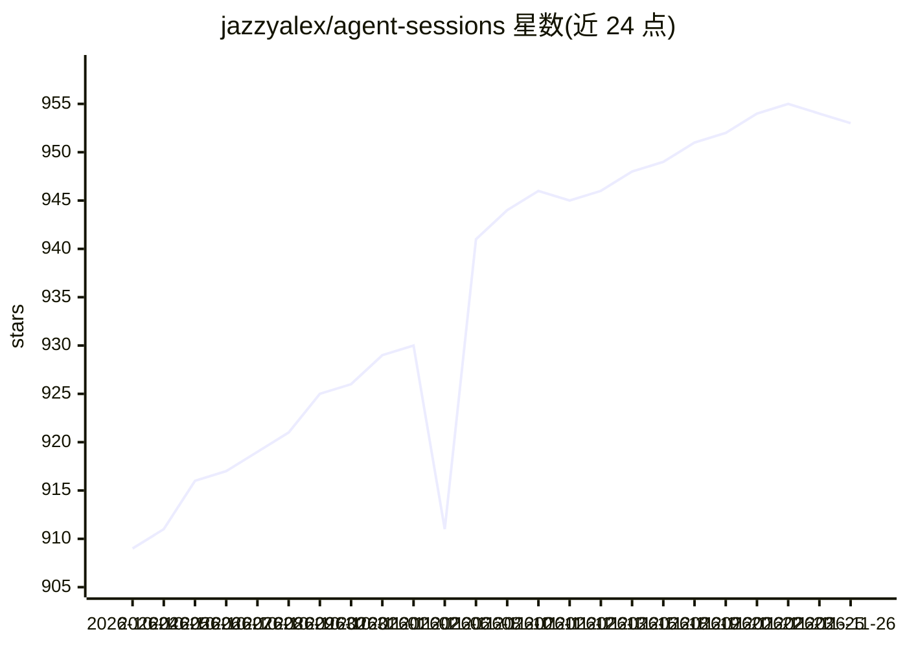

# jazzyalex/agent-sessions

⭐ 953 · Swift · MIT · 推送 2026-11-25 · [GitHub](https://github.com/jazzyalex/agent-sessions) · [官网](https://jazzyalex.github.io/agent-sessions/?campaign=github&ref=about-sidebar) · 个人维护

**macOS 应用：汇总检索并续用多家 AI 编码 agent 的本地会话历史**

本地优先的 macOS 应用（需 macOS 14+），将 Codex、Claude Code、Cursor Agent 等 16 种活跃格式的编码 agent 会话历史聚合到统一界面：支持全文检索（短语、文件路径、会话 ID、布尔查询）、阅读 transcript、复制 resume 命令并在 Terminal/iTerm2/Warp/Ghostty 等终端中续开 CLI 会话；提供 Codex/Claude 的逐会话配额消耗计量（5 小时/周窗口、token、API 等价成本估算）与 Session Info 元数据面板。索引与解析全部本地完成，不上传会话数据，无遥测。DMG 或 Homebrew 安装，更新经 Sparkle 签名分发。

## 筛选速览

| 维度 | 判定 | 备注 |
|---|---|---|
| AI 角色 | `ai-ecosystem` | LLM/agent 周边工具 |
| 许可风险 | `permissive` | MIT |
| 部署形态 | `desktop` | 安装包/桌面程序 |
| 模型依赖 | — | README 未给出锁定关系 |
| 硬件要求 | — | 无带数字的原话,不猜 |
| 安装摩擦 | `low` | 无编译、无系统依赖或容器化 |
| 成熟度 | — | 结构信号不足 |

## 能力要点

- 聚合 16 种 agent 会话格式，统一本地检索与 resume
- 逐会话配额计量：5 小时/周窗口、token 速率、API 等价成本估算
- Session Info 面板展示 provider、模型、token 组成、价格估算
- 本地索引与解析，无遥测，格式维护者清单见 STEWARDS.md

## 适用场景

- 找回并续用散落在多个 CLI agent 里的历史会话
- 监控 Codex/Claude 配额在哪些会话上消耗最快
- 按 agent、模型对比使用成本与 token 消耗

## 场景标签

 · 领域:开发者工具/AI 编码 agent 会话管理

## 证据(README 行号)

> L7: Search local conversations from Codex, Claude Code, Cursor, and **13 other coding agents** in one Mac app. Read the 
> L50: |Source|Local history|Resume|
> L112: - Transcript discovery, parsing, indexing, search, and navigation happen locally.

## 星数曲线

2026-10-24 909 → 2026-11-26 953（+44）

---
*卡片 v1 · prompt 1.4 · 生成 2026-11-25 · 置信度 high · 依据 README sha `c12e61374014` · [字段定义](../../DATASET.md)*
