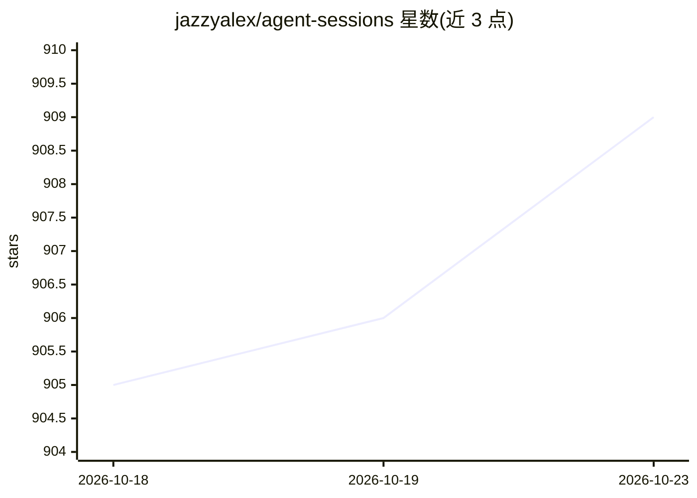

# jazzyalex/agent-sessions

⭐ 909 · Swift · MIT · 推送 2026-10-22 · [GitHub](https://github.com/jazzyalex/agent-sessions) · [官网](https://jazzyalex.github.io/agent-sessions/?campaign=github&ref=about-sidebar) · 个人维护

**本地优先的 macOS 应用：搜索与恢复 16 种 AI 编码代理的会话历史**

macOS 桌面应用，读取并索引 Codex、Claude Code、Cursor、Copilot CLI、OpenCode 等 16 种 AI 编码代理的本地会话记录，提供跨来源的提示/响应/工具调用/文件路径搜索，可复制或经 Terminal/iTerm2/Warp 恢复受支持的 CLI 会话，并以 Session Info 展示模型、token、定价等元数据。Quota Meter 按会话追踪 Codex 与 Claude 的 5 小时/周配额消耗，以官方 API 费率估算费用。索引与解析全部本地完成，无遥测，会话文件只读不重写。

## 筛选速览

| 维度 | 判定 | 备注 |
|---|---|---|
| AI 角色 | `ai-ecosystem` | LLM/agent 周边工具 |
| 许可风险 | `permissive` | MIT |
| 部署形态 | `desktop` | 安装包/桌面程序 |
| 模型依赖 | — | README 未给出锁定关系 |
| 硬件要求 | — | 无带数字的原话,不猜 |
| 安装摩擦 | `low` | 无编译、无系统依赖或容器化 |
| 成熟度 | — | 结构信号不足 |

## 能力要点

- 搜索 16 种编码代理的本地会话历史（提示、响应、工具调用、错误、文件路径）
- 按会话追踪 Codex/Claude 配额消耗，含 5 小时/周窗口与 API 等效费用估算
- Session Info 展示各来源的模型、token、活动与定价元数据，不支持的字段明确标注不可用
- 本地索引、只读解析、无遥测，仅更新检查与公开价格表走网络

## 适用场景

- 跨多个编码代理工具找回过去的会话与上下文
- 查看哪个 Codex 或 Claude 会话在消耗配额
- 复制恢复命令或直接在终端中重新打开 CLI 会话

## 场景标签

 · 领域:开发者工具/AI 代理会话管理

## 证据(README 行号)

> L7: Search local conversations from Codex, Claude Code, Cursor, and **13 other coding agents** in one Mac app. Read the 
> L27: - **Find past work.** Search prompts, responses, tool calls, command output, errors, file paths, and supported imag
> L147: - Transcript discovery, parsing, indexing, search, and navigation happen locally.

## 星数曲线

2026-10-18 905 → 2026-10-23 909（+4）

---
*卡片 v1 · prompt 1.4 · 生成 2026-10-21 · 置信度 high · 依据 README sha `72c260b99e37` · [字段定义](../../DATASET.md)*
