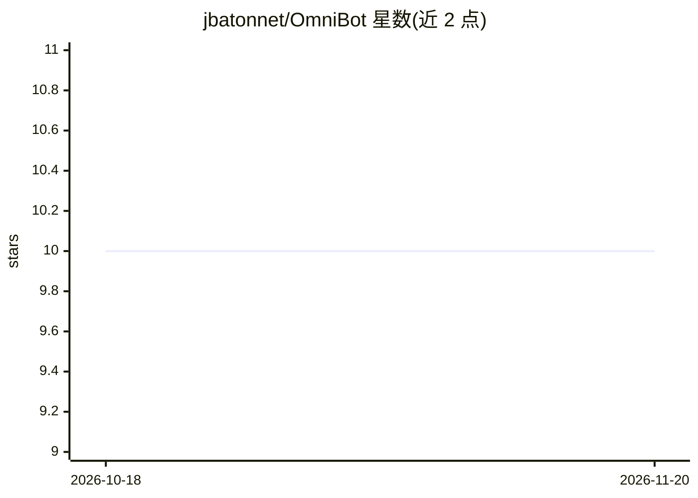

# jbatonnet/OmniBot

⭐ 10 · C# · MIT · 推送 2025-12-20 · [GitHub](https://github.com/jbatonnet/OmniBot) · 个人维护

**.NET 开发者构建文本/语音 bot 的抽象库框架**

面向 .NET 开发者的框架库集合，用于简化文本与语音 bot 的开发。通过抽象对话、音频与语音接口，接入 Discord、Twilio、WebRTC、浏览器与本地麦克风等音频源；ML 组件支持本地运行语音检测（YAMnet、Silero VAD）与 Whisper 转录，强调尽可能本地运行。按模块划分为 Common、Azure、Blazor、Discord、ML、OpenAI、SIPSorcery、Windows 等库。

## 筛选速览

| 维度 | 判定 | 备注 |
|---|---|---|
| AI 角色 | `ai-ecosystem` | LLM/agent 周边工具 |
| 许可风险 | `permissive` | MIT |
| 部署形态 | `None` |  |
| 模型依赖 | — | README 未给出锁定关系 |
| 硬件要求 | — | 无带数字的原话,不猜 |
| 安装摩擦 | `low` | 无编译、无系统依赖或容器化 |
| 成熟度 | — | 结构信号不足 |

## 能力要点

- 统一抽象对话、音频与语音接口（OmniBot.Common）
- 支持 Discord、Twilio、WebRTC、浏览器与本地麦克风等多平台音频源
- 本地运行语音检测模型（YAMnet、Silero VAD）与 Whisper 转录
- 抽象 OpenAI 聊天补全与 Azure 语音服务接口

## 适用场景

- 在 .NET 中开发接入 Discord 的文本/语音 bot
- 通过 Twilio SIP 或 WebRTC 让 bot 与电话/PSTN 用户交互
- 在本地运行语音检测与转录，减少对云服务依赖

## 场景标签

 · 领域:开发框架/机器人

## 证据(README 行号)

> L3: OmniBot is a small framework of libraries to ease the development of text and audio based bots in .NET. It includes 
> L6: It also includes different components working with ML and LLMs, with a focus on being able to run everything locally
> L10: - **OmniBot.Common** : Main library abstracting conversation, audio and speech interfaces.

## 星数曲线

2026-10-18 10 → 2026-11-20 10（+0）

---
*卡片 v1 · prompt 1.4 · 生成 2026-11-19 · 置信度 high · 依据 README sha `3a994cd64419` · [字段定义](../../DATASET.md)*
