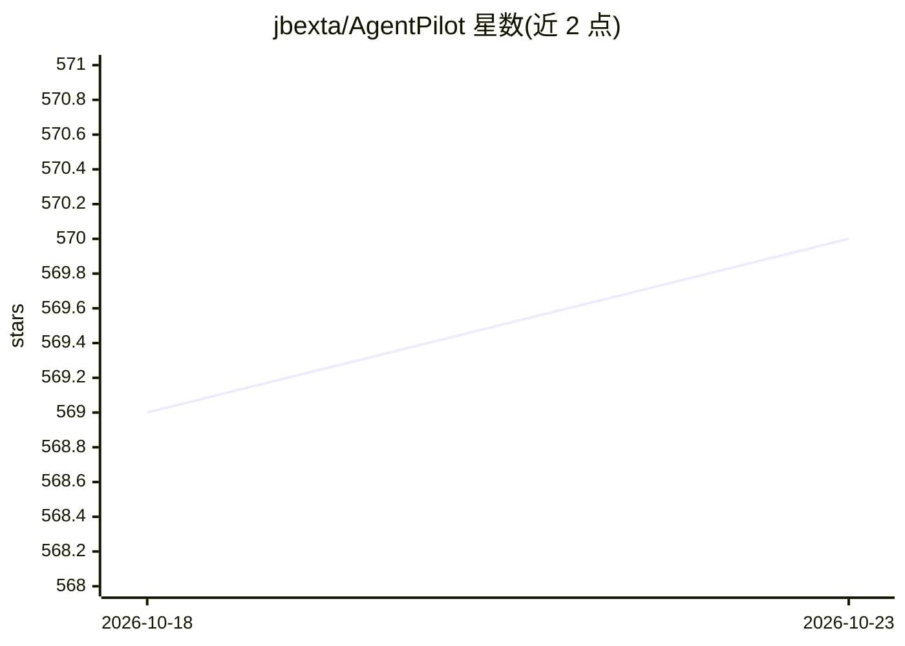

# jbexta/AgentPilot

⭐ 570 · Python · AGPL-3.0 · 推送 2026-04-14 · [GitHub](https://github.com/jbexta/AgentPilot) · [官网](https://agentpilot.ai) · 个人维护

**桌面端 AI 工作流自动化平台：创建、组织并执行多成员 AI 工作流**

Agent Pilot 是一个工作流自动化系统：通过图形界面创建由 Agent、代码、提示词、模块等成员组成的工作流，支持分支对话、可嵌套区块、工具、Python 模块运行时导入、AI 生成界面与定时任务（付费功能）。集成 LiteLLM 支持 100+ 模型提供商（Ollama、Anthropic、Azure 等），集成 Open Interpreter 可在 9 种语言中执行代码。以 Linux/Windows/Mac 预编译二进制分发，也可从源码构建。语音功能标注即将回归，部分插件（CrewAI）当前禁用。

## 筛选速览

| 维度 | 判定 | 备注 |
|---|---|---|
| AI 角色 | `ai-native` | 本体是模型或模型工具 |
| 许可风险 | `viral` | AGPL-3.0 |
| 部署形态 | `None` |  |
| 模型依赖 | local-ok | 支持本地模型 |
| 硬件要求 | — | 无带数字的原话,不猜 |
| 安装摩擦 | `low` | 无编译、无系统依赖或容器化 |
| 成熟度 | — | 结构信号不足 |

## 能力要点

- 图形式多成员工作流（Agent/Code/Prompt/Module 等，可嵌套与并行执行）
- 集成 LiteLLM 支持 100+ 模型提供商
- 集成 Open Interpreter，可执行 9 种语言的代码
- 分支式对话：消息、工具与代码可编辑后重跑

## 适用场景

- 在桌面端搭建并实时对话运行多成员 AI 工作流
- 把多成员工作流保存为可复用区块或工具
- 定时按自然语言表达式自动运行工作流（付费功能）

## 场景标签

`Agent 框架` `多智能体` `工作流自动化` · 领域:Agent 开发

## 证据(README 行号)

> L6: A versatile workflow automation system. Create, organize, and execute complex AI-driven tasks.

## 星数曲线

2026-10-18 569 → 2026-10-23 570（+1）

---
*卡片 v1 · prompt 1.4 · 生成 2026-10-21 · 置信度 high · 依据 README sha `84102cf7dae8` · [字段定义](../../DATASET.md)*
