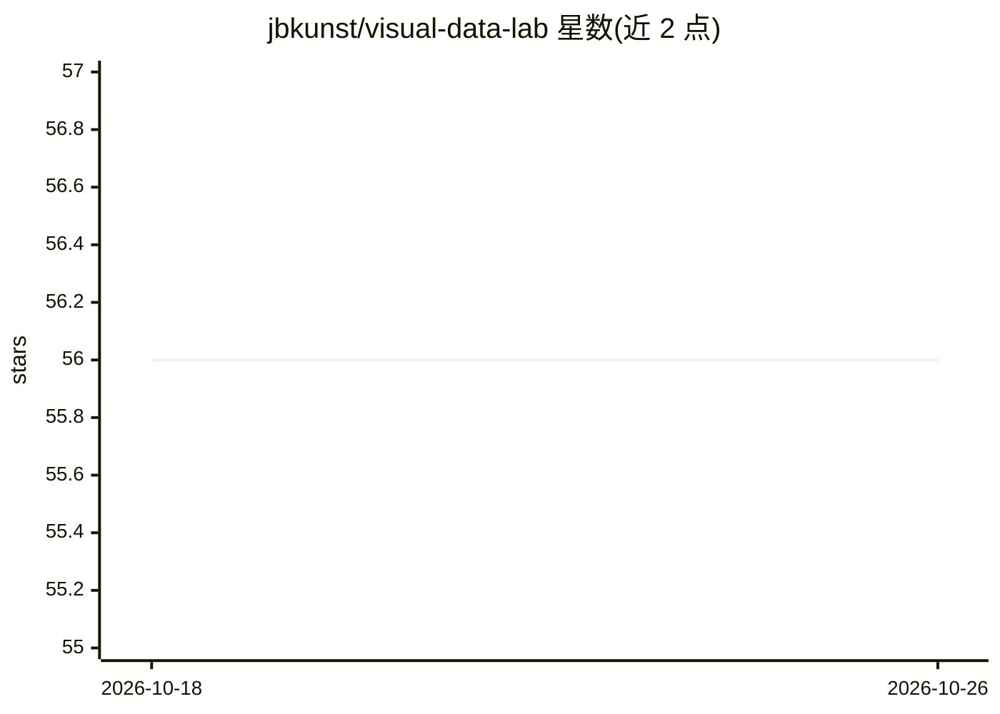

# jbkunst/visual-data-lab

⭐ 56 · HTML · 推送 2026-10-25 · [GitHub](https://github.com/jbkunst/visual-data-lab) · [官网](https://jkunst.com/visual-data-lab/) · 个人维护

**个人数据/统计/机器学习交互实验应用的 Shiny 画廊**

由 Joshua Kunst（jbkunst）维护的个人项目：以 R Shiny 为载体，一个顶层文件夹对应一个交互式应用，围绕统计、机器学习与可视化主题（如 kmeans、underfitting-overfitting）供学习者探索。每个应用带 DESCRIPTION 元数据、readme 说明与截图，通过 GitHub Actions 构建静态画廊站点，默认以 Shinylive（WebAssembly）在浏览器运行，可选部署到 Posit Connect Cloud。应用按依赖栈划分为 standard/modeling/extended/light 四个 Shinylive 依赖池以优化首次加载；共享视觉主题由 vdltheme 包（捆绑 IBM Plex Sans 字体）提供，该包发布带 WebAssembly 构建产物。

## 筛选速览

| 维度 | 判定 | 备注 |
|---|---|---|
| AI 角色 | `ai-knowledge` | 知识聚合/清单类 |
| 许可风险 | `none` | — |
| 部署形态 | `None` |  |
| 模型依赖 | — | README 未给出锁定关系 |
| 硬件要求 | — | 无带数字的原话,不猜 |
| 安装摩擦 | `low` | 无编译、无系统依赖或容器化 |
| 成熟度 | — | 结构信号不足 |

## 能力要点

- 一文件夹一应用的 Shiny 应用画廊结构，含 DESCRIPTION 元数据规范
- Shinylive 浏览器运行时 + 四类依赖池（standard/modeling/extended/light）优化冷启动
- 共享 vdltheme 主题包，带 WebAssembly 发布工作流（r-wasm/actions）
- 支持本地运行（R/run_app.R）与 Posit Connect Cloud 服务端部署两种运行时

## 适用场景

- 通过交互应用直观探索统计与机器学习概念（如聚类、过拟合）
- 作为 Shiny/Quarto 应用画廊的组织与发布模板参考
- 教学场景中让学生动手调节参数观察结果变化

## 场景标签

`教程课程` · 领域:学习与行业

## 证据(README 行号)

> L1: # Visual Data Lab
> L3: Interactive experiments in data, statistics, machine learning, and visualization.
> L7: Visual Data Lab is a personal space to build interactive experiments around data, statistics and machine learning. I

## 星数曲线

2026-10-18 56 → 2026-10-26 56（+0）

---
*卡片 v1 · prompt 1.4 · 生成 2026-10-24 · 置信度 mid · 依据 README sha `a6789ce8fcfe` · [字段定义](../../DATASET.md)*
