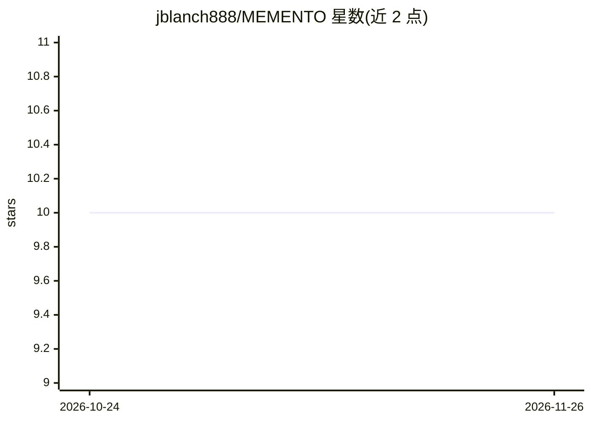

# jblanch888/MEMENTO

⭐ 10 · Shell · MIT · 推送 2026-11-10 · [GitHub](https://github.com/jblanch888/MEMENTO) · [官网](https://jblanch888.github.io/MEMENTO/) · 个人维护

**让 AI 助手跨数百次会话保持项目知识与工作规则的仓库内框架**

一套存放在代码仓库中的方法论框架，分两部分：'memory prosthesis' 记录项目状态、决策理由与证据，按四个层级组织（从当前任务笔记到带日期的归档），供 AI 助手在新会话或上下文丢失时读取；'operational protocols' 规定助手的工作规则，包括完成标准由用户确认、主张附证据、大任务先保存经批准的计划、小步变更、发布类操作需审批及'可证伪治理'控制。仓库提供框架模板、上手指南与历史档案，面向进行长期 AI 辅助开发的项目团队。

## 筛选速览

| 维度 | 判定 | 备注 |
|---|---|---|
| AI 角色 | `ai-ecosystem` | LLM/agent 周边工具 |
| 许可风险 | `permissive` | MIT |
| 部署形态 | `None` |  |
| 模型依赖 | — | README 未给出锁定关系 |
| 硬件要求 | — | 无带数字的原话,不猜 |
| 安装摩擦 | `low` | 无编译、无系统依赖或容器化 |
| 成熟度 | — | 结构信号不足 |

## 能力要点

- 四层级的会话间项目记忆（工作上下文到证据归档）
- 工作协议：完成标准由用户确认、主张附证据、发布需审批
- 可证伪治理：每个控制需失败判据与复审日期
- 提供渐进式上手路径与 2025 版存档

## 适用场景

- 让 AI 助手在数百次会话中延续项目而不遗忘早期决策
- 为 AI 辅助开发建立审批与证据规则
- 记录已尝试并否决的方案避免重复踩坑
- 团队为业务工作流建立共享记忆系统

## 场景标签

`Agent 记忆` · 领域:Agent 开发

## 证据(README 行号)

> L5: It has two parts: the *memory prosthesis*, saved notes and evidence the assistant reads to pick up where earlier ses
> L39: |`framework/`|**Use it in a project:** templates for the rules, the playbooks, the four tiers of project notes, and
> L46: - **The memory prosthesis.** Four tiers of saved notes, from short working-context files for the current task to an

## 星数曲线

2026-10-24 10 → 2026-11-26 10（+0）

---
*卡片 v1 · prompt 1.4 · 生成 2026-11-19 · 置信度 mid · 依据 README sha `2f1b156cf429` · [字段定义](../../DATASET.md)*
