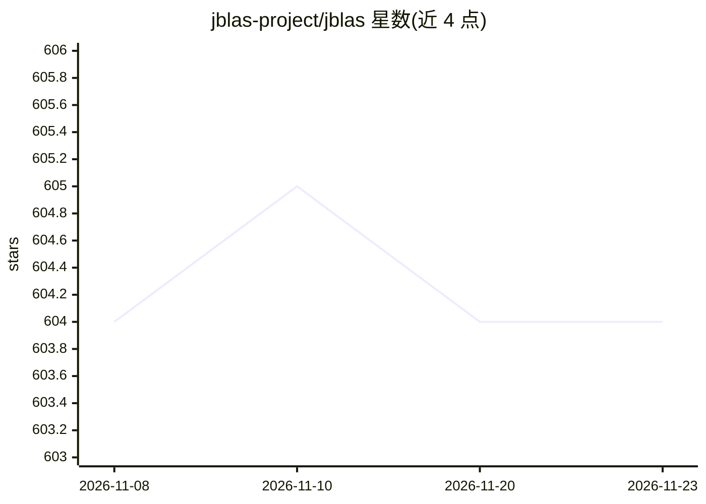

# jblas-project/jblas

⭐ 604 · Java · BSD-3-Clause · 推送 2026-11-04 · [GitHub](https://github.com/jblas-project/jblas) · [官网](http://jblas.org) · 组织维护

**Java 线性代数矩阵库：封装 BLAS/LAPACK 原生库**

面向 Java 开发者的矩阵运算库，通过调用本地高性能 BLAS 与 LAPACK 实现（如 ATLAS、plain lapack）提供线性代数计算。发布的 jar 包内置各平台原生库，加入 classpath 后自动解压到临时文件并加载。也可通过 Maven 依赖引入。从源码构建时 Java 部分用 Maven 编译，完整原生构建需要 Ruby（代码生成脚本）、BLAS/LAPACK 实现及 Fortran 源码。以 BSD 风格许可分发。

## 筛选速览

| 维度 | 判定 | 备注 |
|---|---|---|
| AI 角色 | `ai-ecosystem` | LLM/agent 周边工具 |
| 许可风险 | `permissive` | BSD-3-Clause |
| 部署形态 | `None` |  |
| 模型依赖 | — | README 未给出锁定关系 |
| 硬件要求 | — | 无带数字的原话,不猜 |
| 安装摩擦 | `low` | 无编译、无系统依赖或容器化 |
| 成熟度 | — | 结构信号不足 |

## 能力要点

- Java 矩阵库，封装本地 BLAS/LAPACK（ATLAS 等）
- jar 包自动解压并加载平台相关原生库
- 支持 Maven 依赖引入
- 运行 'java -jar jblas-1.2.5.jar' 可验证安装并查看性能数据

## 适用场景

- 在 Java 项目中做矩阵与线性代数运算
- 机器学习或科学计算场景需要高性能底层库
- 验证本地 BLAS/LAPACK 安装并获得性能基准

## 场景标签

 · 领域:数值计算/科学计算

## 证据(README 行号)

> L1: jblas is a matrix library for Java which uses existing high
> L2: performance BLAS and LAPACK libraries like ATLAS.

## 星数曲线

2026-11-08 604 → 2026-11-23 604（+0）

---
*卡片 v1 · prompt 1.4 · 生成 2026-11-17 · 置信度 mid · 依据 README sha `26f646ea007c` · [字段定义](../../DATASET.md)*
