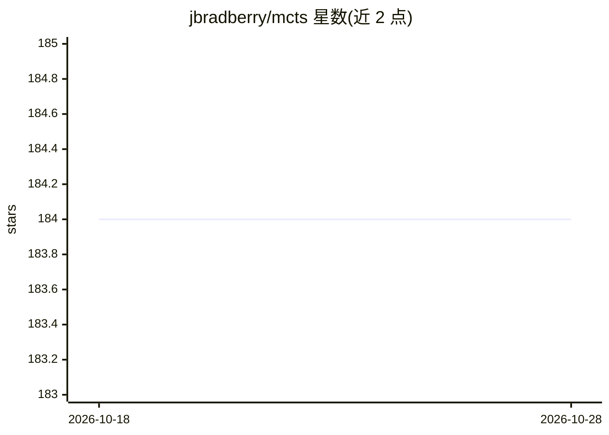

# jbradberry/mcts

⭐ 184 · Python · MIT · 推送 2026-09-30 · [GitHub](https://github.com/jbradberry/mcts) · 个人维护

**基于 UCT 蒙特卡洛树搜索的棋类 AI 玩家库**

用 Python 实现的棋类游戏 AI，核心是 UCT 蒙特卡洛树搜索算法，提供两种玩家变体：jrb.mcts.uct 以节点胜利计数决策，jrb.mcts.uctv 以棋盘评估值决策。需配合 jbradberry 的 boardgame-socketserver 与 boardgame-socketplayer 框架运行，兼容 Reversi、Connect Four、9x9 井字棋、Chong 等已实现游戏。支持思考时间、最大模拟步数、探索系数 C 等参数调节。要求 Python 3.10+ 或 PyPy。

## 筛选速览

| 维度 | 判定 | 备注 |
|---|---|---|
| AI 角色 | `ai-native` | 本体是模型或模型工具 |
| 许可风险 | `permissive` | MIT |
| 部署形态 | `library` | 以包/库形式分发 |
| 模型依赖 | — | README 未给出锁定关系 |
| 硬件要求 | — | 无带数字的原话,不猜 |
| 安装摩擦 | `low` | 无编译、无系统依赖或容器化 |
| 成熟度 | — | 结构信号不足 |

## 能力要点

- 两种 UCT 玩家：胜局计数（jrb.mcts.uct）与棋盘评估值（jrb.mcts.uctv）
- 可调参数：time 思考时间、max_actions 模拟上限、C 探索/利用系数
- 兼容 Reversi、Connect Four、9x9 井字棋、Chong 四种已实现游戏
- 需配合 boardgame-socketserver / boardgame-socketplayer 框架使用

## 适用场景

- 为兼容的棋类框架接入 MCTS AI 玩家进行对弈
- 调整 UCT 参数实验不同游戏下的搜索表现
- 作为蒙特卡洛树搜索算法的 Python 实现参考

## 场景标签

 · 领域:游戏 AI/算法库

## 证据(README 行号)

> L3: This is an implementation of an AI in Python using the UCT Monte Carlo
> L35: This project currently comes with two different Monte Carlo Tree

## 星数曲线

2026-10-18 184 → 2026-10-28 184（+0）

---
*卡片 v1 · prompt 1.4 · 生成 2026-10-22 · 置信度 high · 依据 README sha `af07b171252b` · [字段定义](../../DATASET.md)*
