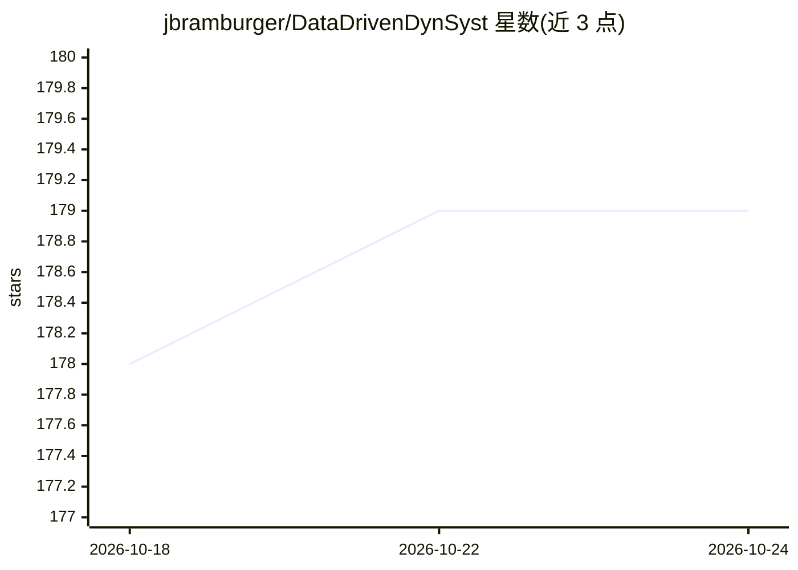

# jbramburger/DataDrivenDynSyst

⭐ — · [GitHub]() · 个人维护

**教科书配套脚本集：用数据驱动方法分析动力系统**

伴随《Data-Driven Methods for Dynamic Systems》一书的 MATLAB 脚本、Julia 脚本与 Jupyter 笔记本合集，按 6 个章节组织：POD、DMD/EDMD/核 DMD、SINDy 稀疏辨识、多项式优化与 Lyapunov 函数、PINN 神经网络求解与预报、自编码器学习共轭映射与坐标变换。示例数据由显式动力系统生成，部分章节含可加载的已训练网络。运行环境为 MATLAB R2019a 与 Python 3.8/TensorFlow，第四章脚本额外需要 YALMIP、MOSEK，部分脚本需要 Chebfun。

## 筛选速览

| 维度 | 判定 | 备注 |
|---|---|---|
| AI 角色 | `ai-knowledge` | 知识聚合/清单类 |
| 许可风险 | `permissive` | — |
| 部署形态 | `None` |  |
| 模型依赖 | — | README 未给出锁定关系 |
| 硬件要求 | — | 无带数字的原话,不猜 |
| 安装摩擦 | `low` | 无编译、无系统依赖或容器化 |
| 成熟度 | — | 结构信号不足 |

## 能力要点

- 按章节覆盖 DMD/EDMD、SINDy、多项式优化、PINN、自编码器等方法实现
- 示例数据由已知动力系统生成，可对照精确解验证方法
- 第五章、第六章附可加载的已训练神经网络

## 适用场景

- 学习教科书章节时运行并复现书中图表结果
- 将 DMD/SINDy/PINN 等方法示例迁移到自己的动力系统数据
- 参考 Koopman 算子与自编码器共轭学习的实现代码

## 场景标签

`教程课程` · 领域:学习与行业

## 证据(README 行号)

> L3: This repository contains the scripts and notebooks that accompany the book Data-Driven Methods for Dynamic Systems.
> L5: The goal of this textbook is to provide an example-driven understanding of how modern computational tools can be app

## 星数曲线

2026-10-18 178 → 2026-10-24 179（+1）

---
*卡片 v1 · prompt 1.4 · 生成 2026-10-22 · 置信度 high · 依据 README sha `b3c1bf791667` · [字段定义](../../DATASET.md)*
